# 2. Vista Lógica

Esta vista explica qué es un trámite en Héron y cómo se mueve dentro del motor. Es el punto de partida: antes de entrar al detalle del JSON o de la infraestructura, conviene entender el modelo conceptual, cómo se registra el avance de un folio y qué mecanismo decide hacia dónde se dirige.

## 2.1 Héron — Motor de workflow

Héron orquesta todos los trámites operativos de la aseguradora. El modelo conceptual tiene tres niveles jerárquicos:

- **Proceso**: define el trámite completo. Toda su configuración vive en MongoDB como documento JSON.
- **Tarea**: nodo del grafo del proceso, asignado a un área/departamento con un SLA en minutos. Puede presentar nombres distintos sin duplicarse en el grafo: si la fase `actualizacion` escribe la llave `aliasTramite` en `datosTarea`, el core la detecta y la usa como nombre visual en la interfaz. Por ejemplo, el área de Siniestros reutiliza un único nodo de evaluación que aparece como "Evaluación Legal", "Evaluación Cobranza" o "Evaluación Enlace" según el estado del trámite.
- **Etapa**: pantalla individual dentro de una tarea. Una tarea puede tener múltiples etapas (pantallas) que forman un mini-grafo propio de navegación, enfocado en cómo se le presenta la información al usuario.

<!-- diagrama: diagramas/02-01-modelo-proceso-tarea-etapa.mmd -->

Cada vez que un usuario avanza en un trámite se generan dos registros complementarios:

- **`TrackingHeron`** (PostgreSQL) — estado observable del folio. El campo `grupoTarea` no controla el flujo; mide la permanencia por **tarea**: cada cambio de tarea genera un nuevo valor consecutivo, y el conjunto de registros con el mismo valor representa todo el tiempo que el trámite estuvo en esa estación de trabajo.
- **`DatosTareasHeron`** (MongoDB) — contiene la información que se va capturando en cada tarea del proceso, conforme a la estructura del frontend definida, organizada en una serie de llaves principales.

Los identificadores siguen un formato jerárquico composicional, definido en `models.py`:

| Entidad | Formato | Ejemplo |
|---|---|---|
| `procesoId` | `{area}-{numProceso}-{version}` | `5-8-1` |
| `tareaId` | `{area}-{numProceso}-{version}-{numTarea}` | `5-8-1-7` |
| `folioProcesoTareaId` | `{folio}-{area}-{numProceso}-{version}-{numTarea}` | `EMS47211-5-8-1-7` |
| `trackingId` | `{folio}-{procesoId}-{numTracking}` | `EMS47211-5-8-1-3` |
| `datosTareaId` | `{folio}-{numTracking}` | `EMS47211-10` |

### El tracking a lo largo del folio

Cada avance genera un nuevo registro en `TrackingHeron` con un `numTracking` consecutivo. El registro anterior pasa a `trackingFinal = False` y solo el último conserva `trackingFinal = True`, que representa el estado activo del folio. El campo `grupoTarea` agrupa los registros que corresponden a la permanencia en una misma tarea.

<!-- diagrama: diagramas/02-02-tracking-folio.mmd -->

### Cómo se mueve el grafo: Autoriza, Rechaza y el sucesor

El grafo de un proceso no es fijo: se recorre en tiempo de ejecución. La forma de moverse de una tarea a otra se define en dos lugares que trabajan juntos, y conviene entenderlos junto con la definición de la tarea, no como un tema aparte.

Cada tarea declara en `TareasHeron` dos listas de tareas sucesoras posibles, separadas por coma:

| Campo | Contenido | Uso |
|---|---|---|
| `autoriza` | Lista de `tareaId` a los que avanza el flujo cuando la condición se cumple | Camino "hacia adelante" |
| `rechaza` | Lista de `tareaId` a los que regresa el flujo cuando la condición no se cumple | Camino "hacia atrás" o alterno |

La clave `sucesion` en el JSON del proceso es la que decide, en cada avance, cuál de esas rutas se toma. Evalúa condiciones sobre los datos del trámite y resuelve tres cosas: a qué **tarea** se dirige el folio (eligiendo de `autoriza` o `rechaza` según el resultado), a qué **usuario** se asigna y en qué **bandeja** queda.

<!-- diagrama: diagramas/02-03-sucesor-autoriza-rechaza.mmd -->

Cada movimiento no solo cambia de tarea: también cambia de **bandeja**, es decir, de área responsable. Un mismo folio recorre varias bandejas a lo largo de su ciclo. El siguiente es un ejemplo ilustrativo del recorrido (los números corresponden al catálogo de bandejas):

<!-- diagrama: diagramas/02-04-cambio-bandejas.mmd -->

Esta mecánica de Autoriza / Rechaza es independiente del trámite: funciona igual para una cotización, una emisión o un siniestro. Es la base del movimiento entre nodos. El detalle completo de la clave `sucesion` —todas las variantes de asignación de usuario, `typeSucesor`, `indexSucesor` y las acciones especiales `repetir`, `proceso` y `subproceso`— se documenta en la [Vista de Desarrollo](03-vista-desarrollo.md#sucesor). Aquí basta con retener que el par `autoriza`/`rechaza` de cada tarea, combinado con la evaluación de `sucesion`, es lo que permite cambiar de grafo.

### Ciclo de vida de un folio

<!-- diagrama: diagramas/02-05-ciclo-vida-folio.mmd -->

### Catálogo de bandejas (áreas)

Cada área tiene un identificador numérico que corresponde al campo `bandeja` del tracking. El catálogo no está en el código: se lee de `ConfigHeron`, en el registro `"Bandejas"`, dentro de la llave `"Catalogo"` (a través del manager `obtenerCatalogoBandejas`).

| ID | Área |
|---|---|
| 0 | Sistemas |
| 1 | Suscripción |
| 2 | Siniestros |
| 3 | Cobranza |
| 4 | Contabilidad |
| 5 | Legal |
| 6 | Finanzas |
| 7 | Recursos Humanos |
| 8 | Emisión |
| 9 | Servicios Generales |
| 10 | Dirección General |
| 11 | Comercial |
| 12 | Auditoría Interna |
| 13 | Tesorería |
| 14 | Actuaría |
| 15 | Enlace |
| 16 | Comunicación |
| 17 | Agentes |
| 18 | Externos |
| 26 | Reaseguro |
| 27 | Estrategia |

### Catálogo de roles

Los roles del sistema determinan qué variante de frontend sirve Héron a cada usuario (el catálogo se encuentra en `apis/Usuarios/catalogos.py`):

| ID | Rol |
|---|---|
| 0 | Administrador |
| 1 | Supervisor |
| 7 | Jefe de Área |
| 2 | Empleado |
| 3 | Agente |
| 6 | SubAgente |
| 4 | Asegurado |
| 5 | Externo |
| 8 | Contratante |
| 9 | Promotor |
| 10 | SubPromotor |
| 11 | Reasegurador |
| 12 | SubReasegurador |

## 2.2 Módulos del sistema

MIDAS 2.0 está organizado en módulos funcionales. Héron actúa como orquestador central; los demás módulos exponen su funcionalidad a través de él cuando participan en un trámite. Las áreas transversales —Usuarios, Talos, Kronos— operan como infraestructura compartida.

<!-- diagrama: diagramas/02-06-modulos-sistema.mmd -->

| Módulo | Propósito |
|---|---|
| **Héron** | Motor de workflow — orquestación de trámites *(módulo central de este documento)* |
| Midas | Pólizas, cotizaciones, endosos y certificados (core del negocio asegurador) |
| Usuarios | Autenticación, roles y permisos |
| Contabilidad | Registros contables, conciliación y reportes |
| Siniestros | Gestión de siniestros, reservas y reclamaciones (core del negocio asegurador) |
| FondoAhorro | Gestión de rescates y administración de ahorro, intereses y aportaciones (core del negocio asegurador) |
| Iris | Gestión de reportes, métricas de venta y atención a clientes |
| Agora | Gestión de paquetes de venta individual y administración de pólizas individuales |
| Talos | Gestión de PLD y seguridad de documentos |
| Hermes | Gestión de notificaciones y alertas |
| Minos | Portal de consejeros para la publicación de reportes |
| FTPS | Portal para transferencia de archivos |
| Kronos | Procesos programados y robots batch |
| Reaseguro | Gestión de reaseguros |
| Extras | Utilidades compartidas |

El catálogo `APLICACIONES` controla a qué módulos puede acceder cada usuario (se encuentra en `catalogos.py`):

| ID | Aplicación |
|---|---|
| 0 | General |
| 1 | Midas |
| 2 | Hermes |
| 3 | Herón |
| 4 | FTPS |
| 5 | Ágora |
| 6 | Talos |
| 7 | Tamías |
| 8 | Iris |
| 9 | Minos |

`Tamías` (ID 7) aparece registrado en el catálogo; su alcance y funcionalidad no se encuentran documentados.

## 2.3 Modelo de datos

MIDAS 2.0 opera sobre tres bases de datos. El router `BaseDatosRouter` en `backend/backend/router.py` dirige cada modelo a su base según su `db_table`: si aparece en la lista `modelsMongo`, va a MongoDB; en caso contrario, a PostgreSQL. El acceso a MIDAS 1.0 no pasa por el ORM de Django; una clase `MidasAPI` usa `pyodbc` directamente para mantener el sistema legado desacoplado.

<!-- diagrama: diagramas/02-07-modelo-datos.mmd -->

Los ocho modelos del core de Héron, definidos en `apis/Heron/models.py`:

| Modelo | Base | Contenido |
|---|---|---|
| `ProcesosHeron` | PostgreSQL | Definición de procesos: `procesoId`, `numProceso`, `version`, `area`, `nombre`, `ssla` |
| `TareasHeron` | PostgreSQL | Tareas de cada proceso: `tareaId`, `numTarea`, `autoriza`, `rechaza`, `ssla`, `tareaFinal` |
| `TramitesHeron` | PostgreSQL | Instancia de un trámite por folio: `folio`, `procesoId`, `usuario`, `fechaInicio`, `fechaFin` |
| `TrackingHeron` | PostgreSQL | Historial de movimientos de cada folio: `trackingId`, `bandeja`, `sucesor`, `estatus`, `usuario`, `trackingFinal` |
| `FoliosHeron` | PostgreSQL | Consecutivos de folios por área: `prefijo`, `folioId`, `areaFolio` |
| `FormulariosHeron` | MongoDB | Configuración JSON de cada proceso-tarea (`formulario`) |
| `DatosTareasHeron` | MongoDB | Datos de formulario capturados, por folio/tracking (`datosTarea`) |
| `ConfigHeron` | MongoDB | Configuraciones del core del negocio: identificadas por `nombreId`, con la configuración en la llave `config` |

`ConfigHeron` concentra la parametrización operativa del motor. Cada documento se identifica por su `nombreId`; entre los registros que consume el core están:

| Registro (`nombreId`) | Para qué se usa |
|---|---|
| `Bandejas` | Catálogo de áreas (llave `Catalogo`) y configuración de bandejas |
| `Sucesion` | Listas de usuarios por área para la asignación por carrusel |
| `Áreas` | Configuración y visibilidad de áreas |
| `Regex` | Expresiones regulares del sistema; la vigencia de documentos vive en `["Documentos"]["Vigencias"]` |
| `SLA` | Parámetros de cálculo de SLA |
| `Robot Acciones` / `Robot Procesos` / `Robot SubProcesos` / `Robot Trámites` | Colas de ejecución diferida de cada robot |
| `Procesos` / `SubProcesos` / `Tareas` | Configuración de procesos, subprocesos y tareas automáticas |
| `PLD` · `Tokens` · `Busqueda` · `Comentarios` · `Pantallas` · `Herramientas` | Parámetros de PLD, tokens externos, búsqueda, comentarios, pantallas y herramientas de negocio |

> **Nota sobre la bitácora.** No existe una colección independiente de bitácoras en Héron. La bitácora de auditoría de un folio se **deriva de `TrackingHeron`** mediante los métodos `obtenerBitacoraTracking` y `obtenerBitacoraTrackingFolio` del manager. Registros históricos y de dominio adicionales (información confidencial de asegurados, movimientos contables, estadísticas de uso) los administran los modelos de sus respectivos módulos, fuera del core de Héron.

`GestionAusencias`, en PostgreSQL, registra las ausencias de los usuarios; el motor de sucesión la consulta para redirigir automáticamente los folios cuando el asignado tiene una ausencia activa.

## 2.4 Variables reservadas en `datosTarea`

El core inyecta y gestiona automáticamente tres variables en cada documento `DatosTareasHeron`. No deben modificarse con operaciones de `actualizacion`; solo pueden usarse como parámetros de entrada en otras fases del pipeline.

| Variable | Contenido | Consecuencia de eliminación |
|---|---|---|
| `infoTramite` | `folioId`, `etapaActual`, `rastreo`, `usuario` y metadatos del proceso | Error HTTP 500 al intentar atender el trámite |
| `visualizarDocumentos` | Índice virtual de todos los documentos del folio | Error HTTP 500 |
| `historialChat` | Lista de comentarios; no existe hasta el primer comentario | Sin error; se pierde el historial |

### `visualizarDocumentos` — estructura por documento

Cada entrada combina archivos subidos por el usuario y archivos generados por el sistema bajo las mismas llaves. El tratamiento del nombre depende de su origen: si el archivo proviene de un input, el core descarta el nombre original y lo renombra con el `id` del input de formulario donde fue cargado; si proviene de un formulario de archivos (`formulario_archivos`), se respeta el nombre del archivo origen.

| Llave | Oblig. | Descripción |
|---|---|---|
| `tipo` | Sí | Categoría del archivo; mapea a una ruta física en el servidor (`Heron`, `polizas`, `facturas`) |
| `nombre` | Sí | Nombre visible para el usuario |
| `referencia` | Sí | Ruta física completa en el servidor |
| `url` | Sí | URL de acceso/descarga |
| `descripcion` | Sí | Descripción del documento |
| `vigencia` | No | Fecha de vencimiento; el core la solicita cuando el nombre coincide con una regex predefinida (identificación oficial, domicilio, cédula de agente), ubicada en `ConfigHeron`, registro `Regex`, en `["Documentos"]["Vigencias"]` |
| `valid` | No | Estado de validación; bloquea el input una vez validado para evitar sobreescritura |
| `date` | No | Fecha de subida o generación |
| `metadata` | No | Pares clave-valor adicionales, visibles desde un ícono informativo en la interfaz |
| `tag` | No | Etiqueta libre; visible en algunos procesos, sin comportamiento estandarizado |

La fase `filtro` del pipeline puede eliminar entradas de `visualizarDocumentos` antes de enviarlas al frontend, controlando qué documentos ve cada rol.

### `historialChat` — estructura de un comentario

| Llave | Descripción |
|---|---|
| `usuario` | Identificador del usuario |
| `area` | Área a la que pertenece |
| `foto` | URL de foto de perfil |
| `nombre` | Nombre visible |
| `hora` | Timestamp asignado por el frontend al enviar |
| `contenido` | Objeto de texto enriquecido (Draft.js); soporta negritas, subrayado y archivos adjuntos |
| `tipo` | `general` · `autoriza` · `rechaza` · `externo` · `area` |

El tipo `area` hace que el comentario sea visible solo para el área que lo escribió. La lista es de solo adición; no hay edición ni eliminación expuesta a los usuarios.

---

<!-- nav -->
<table width="100%">
<tr>
<td align="left"><a href="01-introduccion.md">← Anterior: Introducción</a></td>
<td align="center"><a href="README.md">Principal</a></td>
<td align="right"><a href="03-vista-desarrollo.md">Siguiente: Vista de Desarrollo →</a></td>
</tr>
</table>
