# 3. Vista de Desarrollo

Esta vista está dirigida a quien va a leer, mantener o extender el código y las configuraciones de Héron. Reúne el detalle técnico del motor: cómo está organizado el código, cómo se construye y se renderiza el JSON de un proceso, qué fases ejecuta el backend y en qué orden, qué formularios existen y cómo se mueve un folio entre tareas.

El recorrido sigue el orden natural de aprendizaje: primero cómo está estructurado el frontend y cómo se comunica con el backend, después la anatomía del JSON, luego el pipeline de ejecución y, por último, el detalle del sucesor y de las APIs.

> Para el procedimiento operativo —cómo dar de alta un proceso, sus tareas, permisos y visibilidad paso a paso— consulta el [Playbook: Nuevo Trámite](09-playbook-nuevo-tramite.md). Esta vista explica *cómo funciona*; el playbook explica *cómo hacerlo*.

## 3.1 Organización del código

El backend organiza la lógica de negocio por módulo bajo `backend/apis/`:

| Ruta | Descripción |
|---|---|
| `backend/manage.py` | Punto de entrada Django |
| `backend/backend/ajustes/` | Configuración por entorno: `local.py` · `test.py` · `prod.py` |
| `backend/backend/middleware.py` | Manejo de errores y CORS |
| `backend/backend/router.py` | `BaseDatosRouter` — enruta cada modelo a PostgreSQL o MongoDB |
| `backend/backend/urls.py` | URLs principales |
| `backend/apis/Heron/` | Motor de workflow — módulo central de este documento |
| `backend/apis/Midas/` | Pólizas, cotizaciones, endosos |
| `backend/apis/Usuarios/` | Autenticación, roles, permisos |
| `backend/apis/…` | Demás módulos de negocio |

El módulo Héron tiene una capa dedicada en `apis/Heron/herramientas/` que implementa cada fase del pipeline (un archivo por fase). Cada operación se registra en un diccionario de catálogo (`catalogoValidaciones`, `catalogoActualizaciones`, etc.) y el motor la invoca por nombre desde el JSON. Esto permite extender las capacidades del motor sin modificar el orquestador. Las funciones de dominio de negocio —cotizadores, cálculos de primas, reglas por ramo— viven en `apis/Heron/areas/` y se invocan desde los ejecutores cuando el nombre de la función no está en el catálogo central.

Los endpoints usan URLs con hash MD5 como capa de ofuscación:

```python
import hashlib
hash_url = hashlib.md5("descripcion_interna_endpoint".encode()).hexdigest()
# urls.py:
path("api/<hash_url>/", MiVistaView.as_view())
```

### Estructura del frontend

El frontend está en Next.js y se organiza en cuatro capas. Conviene entenderlo en conjunto antes de entrar al detalle del JSON, porque es lo que da contexto a cómo se comunican el front y el back.

<!-- diagrama: diagramas/03-01-estructura-frontend.mmd -->


| Capa | Archivo(s) | Responsabilidad |
|---|---|---|
| Página | `pages/<portal>/...` | Ruta Next.js; cada archivo es una pantalla |
| HOC | `hocs/app<Portal>.js` | Envuelve la página, fija el `<title>`, gestiona el `token` (login/logout) y publica `UserContext`; monta `BarraNavegacion` y `Footer` |
| Context | `contexts/UserContext.js` · `contexts/InputContext.js` | `UserContext` sostiene la sesión (`token`, `setToken`, `clearToken`); `InputContext` coordina la lógica dependiente entre campos de un formulario |
| Componentes | `components/` (submódulo) | Librería de UI: formularios, tablas, visualizadores |

El flujo de dependencias para una pantalla de Héron: la página se exporta envuelta por su HOC (`export default appHeron(Home)`), que inyecta layout, maneja el token y publica `UserContext`. Dentro de una pantalla de trámite, se renderiza el componente `Tramite` (o `TramitePaginacion`), que recibe la configuración del servidor y **resuelve dinámicamente cada `typeForm` a su componente React** mediante un `switch`, propagando las `propsForm`.

<!-- diagrama: diagramas/03-02-flujo-dependencias-pantalla.mmd -->


### Rutas y aplicativos del frontend

El frontend expone varios portales, cada uno con su HOC. Las rutas de primer nivel bajo `pages/`:

| Ruta | Aplicativo | Propósito |
|---|---|---|
| `/heron/interno` | Héron interno | Núcleo del motor de trámites, con bandejas por rol (empleado, jefe de área, supervisor, agente, promotor, asegurado, visitante) |
| `/heron` | Héron externo | Acceso externo al motor: mis trámites, lista de trámites, nuevo trámite |
| `/agora` | Ágora | Portal de ventas para agentes: cotizador, cotizaciones, ventas, productos, pago de póliza/recibo, recuperación y renovación |
| `/hermes` | Hermes | Portal de negocios y servicios: comisiones, evaluaciones, negocios, productos, métricas y solicitudes de Héron |
| `/tamias` | Tamías | Portal de ahorro voluntario: estado de cuenta, movimientos y pólizas para asegurado, contratante y empleado |
| `/midas` | Midas | Trámites de cliente/agente: actualización y validación de datos fiscales, pre-registro de agente, evaluación de atención |
| `/minos` | Minos | Portal de información fiscal y normativa: ejercicios fiscales, información del sector, manuales y políticas |
| `/talos` | Talos | Búsqueda, validador de QR y reportes |
| `/FTPS` | FTPS | Transferencia segura de archivos para empleados y externos |
| `/iris` | Iris | Portal Iris (acceso y ajustes) |
| `/asegurateHIR` · `/vidasegura` · `/liverpool` · `/pruebaIlustrativa` | Ventas directas | Flujos de venta directa y co-branded: registro de contratante, paquetes y pago |
| `/UNAM` | UNAM | Portal cliente UNAM: consulta y obtención de certificado |
| `/resetPassword` | — | Restablecimiento de contraseña |

`pages/_app.js` es el wrapper raíz: carga estilos y fuentes globales y, en el entorno "Servidor", deshabilita las herramientas de desarrollo del navegador.

### Comunicación frontend–backend

El frontend y el backend se comunican mediante `http://127.0.0.1` en desarrollo; usar `localhost` produce un error CORS porque la política de origen está configurada exactamente sobre esa IP. Las conexiones permitidas se declaran **por ambiente**: cada entorno (local, pruebas, producción) define explícitamente qué conexiones puede realizar el sistema, lo que funciona como una lista blanca que controla la superficie de red.

## 3.2 Estructura del JSON de un proceso

Cada proceso de Héron es un documento JSON en MongoDB (colección `FormulariosHeron`) con la siguiente estructura de primer nivel:

```json
{
  "title": "solicitud - nueva_poliza_grupo",
  "frontend": {},
  "backend":  {},
  "consulta": {},
  "bitacora": {}
}
```

La separación `frontend`/`backend` es estructural: cambiar la interfaz para un rol no requiere tocar la lógica de negocio del servidor. La clave `backend` es **compartida entre todos los roles**; lo que varía por rol es únicamente la vista.

MongoDB tiene un límite práctico de 25–35 MB por documento. Para los procesos cuya configuración supera ese umbral, la sección que excede el límite se almacena como archivo físico en disco; en tiempo de ejecución, el backend lee ese fragmento y lo combina en RAM con el JSON principal extraído de MongoDB. El documento completo ensamblado es lo que recibe el motor; el proceso es transparente para el resto del sistema.

## 3.3 Renderizado del frontend: variantes por rol

Antes del detalle conviene la idea general: el `backend` de un proceso es único, pero el `frontend` puede tener **varias versiones**. El motor elige qué versión renderizar según el usuario autenticado, lo que permite mostrar pantallas distintas a un empleado, un supervisor, un agente o un asegurado sin duplicar la lógica de servidor.

Las variantes se nombran combinando rol, área y un identificador de usuario, siguiendo esta estructura:

```
Frontend{rol}{área}{rfcUsuario / identificadorAgrupador}
```

Esto permite generar diferentes versiones de permisos por rol, por área, por usuario individual o usando un identificador de agrupación. Las claves son **camelCase** en el código Python y en el documento MongoDB; la lógica de selección está en `apiGeneral.py` y evalúa las claves en orden de prioridad creciente: la última que existe en el documento gana.

| Clave (camelCase) | `idRol` | Notas |
|---|---|---|
| `frontend` | Todos | Clave base / fallback universal |
| `frontend{area}` | 2 (Empleado) | Override por área |
| `frontend{area}{usuario}` | 2 | Override por usuario individual |
| `frontendSupervisor` | 0, 1 (Admin, Supervisor) | |
| `frontendSupervisor{area}` / `frontendSupervisor{area}{usuario}` | 0, 1 | Override por área o usuario |
| `frontendJefeArea` | 7 (Jefe de Área) | Con sus overrides por área y usuario |
| `frontendAgente` / `frontendAgente{identificadorAgente}` | 3, 6 | Agente y SubAgente |
| `frontendPromotor` / `frontendPromotor{identificadorPromotor}` | 9, 10 | Promotor y SubPromotor |
| `frontendVisitante` / `frontendVisitante{identificadorExterno}` | 5 | Externo |
| `frontendAsegurado` / `frontendAsegurado{identificadorAsegurado}` | 4 | Asegurado |
| `frontendConsulta` | Endpoint de consulta | Vista de solo lectura |
| `frontendConfig` | Interno | Usado por `FormularioFiltro` para recuperar combinaciones |
| `frontendAgrupador` | Todos | Clave contenedora; puede anidar cualquiera de las variantes anteriores |

El lookup falla si el documento usa PascalCase en lugar de camelCase.

## 3.4 Estructura de una etapa

Cada etapa en `frontend.etapas` se compone de cuatro llaves principales. Como introducción rápida: `title`/`style` definen la presentación, `ruta` arma la navegación breadcrumb, `buttons` define las acciones y `forms` los componentes a pintar. El detalle de cada una viene a continuación.

```json
{
  "0.0": {
    "title": "Datos Generales",
    "style": "HIR",
    "ruta": {
      "0":   "Cotizador",
      "0.0": "Datos Generales",
      "1.0": "Datos Opciones",
      "4.0": "Documentación"
    },
    "buttons": {
      "siguiente": { "type": "submitFormValid", "action": "Siguiente" },
      "anterior":  { "type": "submitEtapa",     "action": "Anterior" }
    },
    "forms": [
      {
        "typeForm":  "Formulario",
        "blockForm": false,
        "validForm": true,
        "refForm":   "datosGenerales",
        "propsForm": {}
      }
    ]
  }
}
```

**Llaves de la etapa:**

| Llave | Descripción |
|---|---|
| `title` | Nombre de la etapa (en el JSON, en inglés); el texto visible puede diferir según traducciones o alias |
| `style` | Tema visual; `"HIR"` aplica el estilo de marca por defecto |
| `ruta` | Objeto cuyas llaves son IDs de etapa y cuyos valores son las etiquetas del breadcrumb; la llave `"0"` (sin decimal) es la sección principal y las decimales, las etapas navegables |
| `buttons` | Botones de la etapa, cada uno con `type` (comportamiento) y `action` (el `accionId` que ejecuta el backend) |
| `forms` | Lista de componentes a renderizar |

**Tipos de botón** (definidos en `Tramite.js`):

| `type` | Descripción |
|---|---|
| `submitFormValid` | Valida y envía el formulario; avanza a la siguiente etapa |
| `submitEtapa` | Navega a otra etapa sin enviar datos |
| `submitForm` | Envía sin validación completa |
| `submitSave` | Guarda parcialmente sin avanzar |
| `function` | Ejecuta una función inline del frontend |

**Llaves obligatorias de cada formulario dentro de `forms`:**

| Llave | Tipo | Descripción |
|---|---|---|
| `typeForm` | String | Tipo de componente React a renderizar |
| `blockForm` | Boolean | `true` bloquea la visualización **y** el backend ignora el valor |
| `validForm` | Boolean | Habilita la validación del formulario |
| `refForm` | String | Llave bajo la que se guardan los datos en `datosTarea` |
| `propsForm` | Object | Props adicionales que dependen del componente (ver catálogo abajo) |

La distinción entre `blockForm` y `readOnly` es relevante: `readOnly=true` bloquea la edición en la interfaz pero el backend **sí** recibe y procesa el valor; `blockForm=true` bloquea la interfaz **y** el backend ignora completamente el valor.

### Catálogo de formularios (`typeForm`) y sus `propsForm`

El valor de `typeForm` se resuelve a un componente React en el `switch` de `construirForm` (`components/Servidor/Formularios/Tramite.js` y `TramitePaginacion.js`). El wrapper inyecta algunas props (`id`, `blockForm`, `datosIniciales`, `token`, `url`, `config`…) y luego expande `{ ...propsForm }`; por eso el contenido válido de `propsForm` depende del componente que se va a renderizar. El catálogo verificable:

| `typeForm` | Componente | `propsForm` principales |
|---|---|---|
| `Formulario` | `Formulario.js` | `title`, `icon`, `legend`, `variant` (Row/Column), `readOnlyForm`, `fields`, `datosdefault`, `query`, `filter`, `useData`, `labelUseData` |
| `FormularioDinamico` | `FormularioDinamico.js` | `title`, `variant`, `readOnlyForm`, `forms`, `datosdefault`, `query`, `filter`, `useData` |
| `FormularioArchivos` | `FormularioArchivos.js` | `title`, `accept`, `types` (def. `["pdf"]`), `namesAccept` (regex), `maxSize` (def. 500), `extension` |
| `FormularioMultiple` | `FormularioMultiple.js` | `title`, `type` (nombre de pestañas), `iconAdd`, `iconRest`, `forms`, `max` (def. 4), `blockButtons` |
| `FormularioTabs` | `FormularioTabs.js` | `title`, `tabs`, `forms`, `nameTabDocuments` |
| `FormularioLista` | `FormularioLista.js` | `title`, `min` (1), `max` (100), `type` ("Opción"), `forms`, `contextForm`, `blockButtons`, `deleteData`, `copyData` |
| `FormularioTabla` | `FormularioTabla.js` | `title`, `numRows` (10), `group`, `placement`, `type` ("Fila"), `headers`, `form`, `min`, `filtro`, `fieldsFilter`, `saveFilter` |
| `FormularioFiltro` | `FormularioFiltro.js` | `title`, `variant`, `forms`, `query`, `filter` (usa `url`/`token` inyectados y la clave `frontendConfig`) |
| `FormularioSelect` | `FormularioSelect.js` | `title`, `titleOptions`, `selectFormsId`, `type`, `packOptions`, `optionalOptions`, `contextDinamicOptions`, `minSelectedOptions`, `validOptions`, `blockOptions`, `blockItems` |
| `FormularioCondicional` | `FormularioCondicional.js` | `type` ("Individual"), `forms` |
| `FormularioCoberturas` | `FormularioCoberturas.js` | `selectFormsId`, `title`, `headers`, `globalData`, `parametersQuery`, `optionalOptions`, `packOptions`, `errorsOptions`, `validOptions`, `blockOptions` *(solo en `Tramite.js`)* |
| `FormularioConsulta` | `FormularioConsulta.js` | `type` ("Individual"), `forms`, `dataRetained`, `datosConsulta` |
| `FormularioConsultaTabla` | `FormularioConsultaTabla.js` | `min`, `max`, `numRows`, `headersSearch`, `headersSelected`, `formSearch`, `formSelected`, `query`, `saveQuery`, `fieldsQuery` *(solo en `Tramite.js`)* |
| `FormularioVisualizador` | `FormularioVisualizador.js` | `title`, `forms` |
| `VisualizadorDocumentos` | `VisualizadorDocumentos.js` | `title`, `valid` (def. true), `remove`, `namesVigencia`, `namesDelete` (regex), `vigencia` |
| `DatosPersonales` | `DatosPersonales.js` | `title`, `tipo`, `usarDatos`, `label` |
| `Domicilio` | `Domicilio.js` | `title`, `label`, `labels`, `usarDatos`, `usarDomicilioExtranjero`, `blockFields` |
| `Cuestionario` | `Cuestionario.js` | `title`, `preguntas` |
| `RegistroBeneficiarios` | `RegistroBeneficiarios.js` | `type` ("Normal"), `max` (4), `label`, `domicilio` |
| `Tabla` | `Tabla.js` | Tabla genérica; no se envía al servidor (está en `formsExcluir`) |

`FormularioCoberturas` y `FormularioConsultaTabla` solo están soportados por `Tramite.js`, no por `TramitePaginacion.js`. `TramitePaginacion.js` agrega el pseudo-tipo `Paginas`, que no es un componente: alimenta el paginador con `numeroPaginas` y `paginaActual`.

<a id="pipeline"></a>

## 3.5 Pipeline de ejecución del backend

Cuando el usuario confirma una etapa, el servidor ejecuta una cadena de fases. Cada fase tiene un archivo ejecutor en `apis/Heron/herramientas/` y consulta un catálogo de operaciones que el JSON invoca por nombre.

| Fase (llave JSON) | Archivo ejecutor | Función de entrada | Catálogo |
|---|---|---|---|
| `depuracion` | `depurarAPI.py` | `obtenerDepuracion(...)` | `catalogoDepuraciones` |
| `prevalidacion` | `preValidacionAPI.py` | `preValidarDatos(...)` | `catalogoValidaciones` |
| `validacion` | `validacionAPI.py` | `validarDatos(...)` | `catalogoValidaciones` |
| `postvalidacion` | `postValidacionAPI.py` | `postValidarDatos(...)` | `catalogoValidaciones` |
| `ensamblar` | `ensamblarAPI.py` | `obtenerEnsamblaje(...)` | `catalogoEnsambles` |
| `consulta` | `consultaAPI.py` | `obtenerConsulta(...)` | `catalogoConsultas` |
| `actualizacion` | `actualizacionAPI.py` | `obtenerActualizacion(...)` | `catalogoActualizaciones` |
| `accion` | `accionAPI.py` | `ejecutarAccion(...)` | `catalogoAcciones` |
| `subaccion` | `subAccionAPI.py` | `ejecutarAccion(...)` | (delegación recursiva) |
| `obtencion` | `obtencionAPI.py` | `obtenerDatos(...)` | `catalogoObtenciones` |
| `filtro` | `filtroAPI.py` | `filtroDatos(...)` | `catalogoFiltros` |
| `configuracion` | `configAPI.py` | `aplicarConfig(...)` | `catalogoObtenciones` |
| `sucesion` | `sucesorAPI.py` | `obtenerSucesor(...)` | lógica de sucesión propia |

### Qué información consume cada fase y sobre qué etapa trabaja

El orden y la semántica de las fases dependen del endpoint que las ejecuta. Un dato clave para configurar correctamente es **sobre qué etapa trabaja cada fase**: la mayoría opera sobre la **etapa actual** (los datos que el usuario acaba de enviar), pero algunas trabajan sobre la **etapa posterior** (la pantalla que se va a renderizar a continuación). Las columnas indican qué recibe cada fase: el JSON que llega del frontend, la unión de ese JSON con el `datosTarea`, y si el resultado se almacena en `datosTarea`.

**Endpoint `AccionesTramite` (avance inter-tarea, hash `12ab8b0b…`)**

| # | Fase | Etapa | Recibe | ¿Almacena en datosTarea? |
|---|---|---|---|---|
| 1 | `depurar` | Actual | JSON del frontend | No |
| 2 | `preValidacion` | Actual | JSON del frontend | No |
| 3 | `validacion` | Actual | Unión front + datosTarea | No |
| 4 | `ensamblar` | Actual | Unión front + datosTarea | Sí (si las validaciones son verdaderas) |
| 5 | `postValidacion` | Actual | Unión front + datosTarea | No |
| 6 | `consulta` | Actual | Unión front + datosTarea | Sí |
| 7 | `actualizacion` | Actual | Unión front + datosTarea | Sí |
| 8 | `accion` | Actual | Unión front + datosTarea | Sí |
| 9 | `subAccion` | Actual | Unión front + datosTarea | Sí |
| 10 | `obtencion` | Posterior | Unión front + datosTarea | No (retorna al frontend) |
| 11 | `filtro` | Posterior | Unión front + datosTarea | No (retorna al frontend) |
| 12 | `sucesor` | — | — | Cambio de tarea |
| 13 | `repetir` | — | — | Cambio de tarea repitiendo la actual |
| 14 | `proceso` | — | — | Genera un nuevo proceso (folio nuevo) |
| 15 | `subProceso` | — | — | Genera un subproceso dentro del proceso actual |
| 16 | `configuracion` | Posterior | Unión front + datosTarea | No (retorna al frontend) |

**Endpoint `AccionesEtapa` (navegación intra-tarea, hash `e6f81c97…`)**

| # | Fase | Etapa | ¿Almacena en datosTarea? |
|---|---|---|---|
| 1 | `depurar` | Actual | No |
| 2 | `preValidacion` | Actual | No |
| 3 | `validacion` | Actual | No |
| 4 | `ensamblar` | Actual | Sí (si las validaciones son verdaderas) |
| 5 | `postValidacion` | Actual | No |
| 6 | `consulta` | Actual | Sí |
| 7 | `actualizacion` | Actual | Sí |
| 8 | `accion` | Actual | Sí |
| 9 | `subAccion` | Actual | Sí |
| 10 | `obtencion` | Posterior | No (retorna al frontend) |
| 11 | `filtro` | Posterior | No (retorna al frontend) |
| 12 | `configuracion` | Posterior | No (retorna al frontend) |

`AccionesEtapa` termina en `configuracion` y **no** ejecuta `sucesion`: navega entre etapas de la misma tarea. Solo `AccionesTramite` cierra con `sucesion` (y sus variantes `repetir`, `proceso`, `subProceso`), que es lo que cambia de tarea.

**Endpoints `Nuevo` (crear folio) y `Atender` (abrir folio pendiente)** ejecutan un subconjunto: `Nuevo` corre `validacion → consulta → actualizacion → accion → subAccion` sobre la etapa actual y `obtencion → filtro → configuracion` sobre la etapa posterior; `Atender` inicia con `preValidacion` y `obtencion` sobre la etapa actual antes de `validacion`, `consulta`, `actualizacion`, `accion`, `subAccion`, cerrando con `filtro` y `configuracion`.

### Grafo consolidado del pipeline

Este diagrama reúne todo el pipeline en una sola vista: qué JSON entra a cada fase (el del frontend y el del `datosTarea`), sobre qué etapa trabaja (actual o posterior), qué fases persisten su resultado en `datosTarea` y cuáles retornan datos al frontend. Corresponde al recorrido completo de `AccionesTramite`.

<!-- diagrama: diagramas/03-03-pipeline-consolidado.mmd -->


El JSON del frontend alimenta `depurar` y `preValidacion` (que trabajan sobre los datos crudos de la etapa); a partir de la unión con el `datosTarea`, el resto de las fases operan sobre la estructura combinada. Las fases de la etapa posterior (`obtencion`, `filtro`, `configuracion`) preparan la siguiente pantalla y su resultado vuelve al frontend sin alterar el `datosTarea`. En `AccionesEtapa` el pipeline es el mismo pero termina en `configuracion`, sin `sucesion`.

### Semántica de las fases

| Fase | Para qué se usa |
|---|---|
| `depurar` | Limpia los datos del frontend antes de unirlos al backend |
| `preValidacion` | Valida los datos del frontend antes de unirlos y permite (o no) el cambio de etapa |
| `validacion` | Valida los datos ya unidos con reglas de negocio y controla el cambio de etapa |
| `ensamblar` | Ensambla los datos en una estructura de JSON definida |
| `postValidacion` | Valida datos y contenido de archivos (documentos obligatorios cargados) |
| `consulta` | Ejecuta funciones que extraen datos antes de renderizar el frontend; persiste el resultado |
| `actualizacion` | Actualiza datos con base en los ya existentes |
| `accion` | Ejecuta funciones de creación/inserción en tiempo del usuario |
| `subAccion` | Igual que `accion`, como acción secundaria |
| `obtencion` | Obtiene información adicional que no se almacena en el `datosTarea` (trabaja sobre la etapa posterior) |
| `filtro` | Quita información del `datosTarea` antes de enviarlo al frontend |
| `configuracion` | Añade funcionalidades o datos al frontend (inyección dinámica) |

## 3.6 Parámetros de las funciones

Las funciones del pipeline reciben sus argumentos mediante dos patrones. La resolución de rutas y valores la hacen funciones auxiliares (`getValuePath`, `findAllOcurrences`, `packDatosNivel`) definidas en `apis/Midas/tools.py` y reexportadas por `apis/Heron/tools.py`.

**`parametros`** — ruta fija en `datosTarea`:

```json
{ "formulario": "datosGenerales", "valor": "rfcContratante" }
```

Si `formulario` es `null`, el `valor` se toma como **valor fijo** (literal), no como una ruta dentro de `datosTarea`:

```json
{ "formulario": null, "valor": "VALOR_FIJO" }
```

**`parametrosDinamicos`** — obtiene parámetros que están en múltiples ramas de un árbol, buscando la llave en cualquier profundidad del documento:

```json
{
  "valor": { "formulario": "form", "valor": "campo", "filtro": "prefijo_", "indexUnion": 0, "indexValor": 1 }
}
```

| Sub-parámetro | Descripción |
|---|---|
| `filtro` | Limita la búsqueda a llaves que cumplen una expresión regular |
| `indexUnion` | Fusiona todas las ocurrencias encontradas en un solo objeto |
| `indexValor` | Profundidad del sub-árbol que se extrae de cada ocurrencia |

## 3.7 APIs del motor Héron

El frontend consume el motor a través de endpoints con hash MD5 definidos en `apis/Heron/urls.py`. Las clases viven principalmente en `apiGeneral.py`; cada rol y la integración con Salesforce reutilizan el mismo flujo en sus propios módulos (`apiEmpleado.py`, `apiSupervisor.py`, `apiExternos.py`, `apiRobot.py`, `apiSalesforce.py`, etc.).

**APIs núcleo del ciclo de un trámite** (en `apiGeneral.py`):

| Endpoint | Hash MD5 | Método | Propósito |
|---|---|---|---|
| `NuevoTramite` | `8607a2a5c0cbf80768fd18803f29a66a` | POST | Despliega el formulario para crear un folio nuevo |
| `AtenderTramite` | `470a24980f25f6f40ea9429d9ade20e3` | POST | Abre un folio pendiente desde la bandeja |
| `EmpezarTramite` | `c84eab7774716fc0886db40c531f6c0c` | POST | Toma un folio para empezar a atenderlo |
| `AccionesEtapa` | `e6f81c97b6ca16f77d6be7914f724eb0` | POST | Ejecuta una acción dentro de una etapa (navegación intra-tarea); no ejecuta `sucesion` |
| `AccionesTramite` | `12ab8b0becf1e060fb004587c127a5c0` | POST | Ejecuta una acción sobre el trámite (aceptar, rechazar, detener); pipeline completo con `sucesion` |

**Variantes de herramienta, consulta y bitácora** (también en `apiGeneral.py`, señaladas para completar el detalle):

| Endpoint | Clase | Propósito |
|---|---|---|
| `AtenderHerramienta` | `APIAtenderHerramienta` | Despliega el formulario de una herramienta de negocio |
| `AccionesHerramienta` | `APIAccionesEtapaHerramienta` | Ejecuta las acciones de una herramienta; agrega la fase `herramientas` |
| `AtenderConsultaDatos` | `APIAtenderConsultaDatos` | Despliega el formulario de una consulta de datos |
| `AccionesConsultaDatos` | `APIAccionesEtapaConsultaDatos` | Ejecuta acciones de la consulta de datos (no persiste en `datosTarea`) |
| `AccionesEtapaConsulta` | `APIAccionesEtapaConsulta` | Acción de consulta sobre una etapa; añade el sufijo `Consulta` al `accionId` y usa la variante `frontendConsulta` |
| `AccionesEtapaBitacora` | `APIAccionesEtapaBitacora` | Acción sobre una etapa en modo bitácora; usa la variante `frontendBitacora` |

Además de estas, `apiGeneral.py` expone endpoints de bandejas y listados (nuevos, en proceso, terminados), asignación y transferencia de folios, notificaciones, descarga de archivos, y utilidades de administración de folios (cancelar, completar, reactivar, migrar de versión). Cada rol (`apiEmpleado`, `apiJefeArea`, `apiSupervisor`, `apiAgente`, `apiPromotor`, `apiVisitante`, `apiAsegurado`) replica la familia de endpoints de bandeja con su propio hash; `apiRobot` y `apiSalesforce` replican `NuevoTramite`, `AccionesEtapa` y `AccionesTramite` para la ejecución diferida y para la integración CRM.

### Cómo recibe la petición el motor

Los endpoints de acción (`AccionesEtapa`, `AccionesTramite` y sus variantes) usan `AutenticacionHeron` + `IsAuthenticated` y reciben del cliente:

| Campo | Contenido |
|---|---|
| `accionId` | Identificador de la acción del botón presionado |
| `formId` | Cadena que codifica `tramiteId`, `etapaActualId` y `trackingActualId` (separados por `-`) |
| `formData` | JSON con los datos capturados en la etapa |
| `documentos` | JSON de referencias de documentos, más los archivos en `request.FILES` |

El `datosTarea` **no** viaja en la petición: el motor lo recupera del último registro almacenado del folio (`DatosTareasHeron`) y lo combina con `formData`. La etapa actual se deriva de `formId` y de `infoTramite`. La respuesta es la estructura de formulario que renderiza el frontend, con el código HTTP que corresponda a la validación.

<a id="sucesor"></a>

## 3.8 El sucesor: cómo se cambia de tarea

El sucesor es el mecanismo que mueve el folio de una tarea a otra. Se resuelve en `sucesorAPI.py` (`obtenerSucesor`) y solo lo ejecuta `AccionesTramite`. El resultado es una tupla `(usuario, bandeja, sucesor, estatus, etapaId)` con la que el motor crea el siguiente `TrackingHeron`.

### La cadena Autoriza / Rechaza

Cada tarea declara en `TareasHeron` dos listas de tareas sucesoras, separadas por coma: `autoriza` (camino cuando la condición se cumple) y `rechaza` (camino cuando no). La clave `sucesion` del JSON evalúa una condición y elige de qué lista tomar el sucesor, usando dos parámetros:

- `typeSucesor` — indica de qué lista se resuelve: `"Autoriza"` toma de `TareasHeron.autoriza`, `"Rechaza"` toma de `TareasHeron.rechaza`.
- `indexSucesor` — posición dentro de la lista (por si `autoriza`/`rechaza` tienen varias tareas).

Si la validación de la sucesión resulta verdadera, se toma la lista indicada por `typeSucesor`; si resulta falsa, se toma la contraria. Esto permite que una misma tarea tenga un botón "Autorizar" que avanza y un botón "Rechazar" que regresa a captura, cada uno con su propia configuración.

```json
{
  "sucesion": {
    "sucesor": "3",
    "validacionSucesion": {
      "validacion": "==",
      "opciones": {
        "*": {
          "sucesor": "3",
          "usuario": "?usuarioCarrusel",
          "bandeja": 12,
          "estatus": 0,
          "etapaId": "0.0",
          "indexSucesor": 0,
          "typeSucesor": "Autoriza",
          "validacionSucesion": null
        }
      },
      "parametros": { "opcion": { "formulario": null, "valor": "AUTORIZADA" } },
      "parametrosDinamicos": { "valor": { "formulario": "datosSolicitud", "valor": "estatusSolicitud" } }
    }
  }
}
```

El árbol `validacionSucesion` es recursivo: cada opción puede contener a su vez otra `validacionSucesion`, formando un árbol de decisión. La entrada `"*"` actúa como comodín que ejecuta el validador y, si pasa, recursa.

### Llaves de un nodo de sucesión

| Llave | Descripción |
|---|---|
| `sucesor` | Sucesor por defecto si no se cumple ninguna condición |
| `usuario` | A quién se asigna el folio (ver variantes abajo) |
| `bandeja` | Área/bandeja destino |
| `estatus` | Estatus del trámite en el destino (`0` pendiente, `3` finalizado…) |
| `etapaId` | Etapa en la que inicia el sucesor (por defecto `"0"`) |
| `indexSucesor` | Índice dentro de la lista `autoriza`/`rechaza` |
| `typeSucesor` | `"Autoriza"` o `"Rechaza"` — de qué lista se resuelve |
| `validacionSucesion` | Sub-árbol de condiciones anidadas (`null` si no hay) |

### Variantes de asignación de usuario

El campo `usuario` acepta valores especiales que el motor resuelve en tiempo de ejecución. Son las variantes que permiten mover el nodo hacia el usuario correcto:

| Valor | A quién resuelve |
|---|---|
| `"?"` | El mismo usuario que envió (de `infoTramite.usuarioDinamico` o `infoTramite.usuario`) |
| `"?TareaProcesada"` | El usuario que atendió una tarea anterior específica (consulta el `TrackingHeron` previo) |
| `"?TareaProcesadaUsuario"` | Usuario guardado de una tarea previa (`infoTramite.usuario{tareaId}`), validando que siga activo |
| `"?usuarioCarrusel"` | Round-robin del área, tomado de `ConfigHeron` registro `Sucesion` |
| `"?usuarioSiniestros"` | `infoTramite.usuarioSiniestro` (con su bandeja) |
| `"?usuarioDefault"` | `infoTramite.usuarioSuscriptor` o `infoTramite.usuarioAutorizante` |
| `"?usuarioAutorizacionSiniestros"` | `infoTramite.infoAutorizante.usuario` |
| `"?usuarioAutorizante"` | Supervisor obtenido con `Empleados.objects.obtenerAutorizante(rfc=...)` |
| `null` | Sin dueño explícito; el folio cae a la bandeja del área |

Después de resolver el usuario, el motor consulta `GestionAusencias`: si el asignado tiene una ausencia activa, el folio se redirige automáticamente a su `reemplazoId`.

### Acciones especiales de sucesión

Además de un `tareaId`, las listas `autoriza`/`rechaza` pueden contener acciones especiales que ejecutan robots dedicados (ver [Vista de Procesos](04-vista-procesos.md#robots)):

| Acción | Ejecutor | Efecto |
|---|---|---|
| `repetir` | `repetirAPI` | Reingresa a la tarea actual (bucle dentro de la misma tarea) |
| `proceso` | `procesoAPI` | Genera un proceso independiente (folio nuevo) que corre en paralelo |
| `subProceso` | `subProcesoAPI` | Genera un subproceso embebido; el folio padre queda en espera hasta que termina |

<a id="condiciones"></a>

## 3.9 El árbol de condiciones: if, elif y switch

La lógica condicional de Héron no se escribe en código: se declara como un **árbol recursivo de `opciones`**. El mismo mecanismo se reutiliza en tres lugares —la fase `validacion` (y `prevalidacion`/`postvalidacion`), la clave `sucesion` (dentro de `validacionSucesion`) y el bloque `campos{Fase}` de las fases de escritura— así que entenderlo una vez sirve para todas. Lo resuelve `validarDatosRecursivo` en `validacionAPI.py` (y su gemelo `obtenerSucesorRecursivo` en `sucesorAPI.py`).

Esta sección traduce ese árbol a las tres estructuras de control equivalentes en Python: `if`, `if/elif/else` y `switch`. Es el apoyo para configurar validaciones y sucesiones sin adivinar cómo se evalúan.

### Cómo evalúa el motor una regla

Cada regla vive bajo `camposValidaciones` con la forma `{ "operador~alias": { respuesta, parametros, parametrosDinamicos, opciones } }`:

- El **operador** (`==`, `!=`, `>`, `<`, `between`, `regex`, `in`, `contieneDatos`… del `catalogoValidaciones`) compara el **valor resuelto** (`parametrosDinamicos.valor`) contra la llave de cada opción.
- Una **llave literal** (`"VIGENTE"`, `"GMM"`, `"100000"`) se pasa al operador como valor a comparar; si la condición se cumple, el motor entra en esa rama y hace **`break`** —el primer caso que coincide gana—. Es el comportamiento de un `case` de switch.
- La llave **`"*"`** ejecuta el operador sin compararlo contra un literal y, si pasa, **recursa sin `break`**: funciona como un `if` guardia o como la rama `else`/default.
- `estatus.valido: false` dentro de una opción **invierte** su sentido: si el operador se cumple, el motor lo trata como corte y devuelve su `respuesta` (condición negada).
- Si ninguna opción resulta válida, la regla devuelve su `respuesta` de nivel superior (con código `400`).
- El sufijo `~alias` da unicidad a la llave (un JSON no admite dos llaves iguales); el motor usa solo la parte izquierda (`split("~")[0]`) como operador. En el literal, `|` significa OR (`"A|B"`).

<!-- diagrama: diagramas/03-04-arbol-condiciones.mmd -->


### 1. `if` — una guardia simple

Un solo `if`: exige que una condición se cumpla y, si no, corta con un mensaje. Se expresa con una regla cuya `opciones` tiene solo `"*"`.

```python
# Python
if not (datosPoliza["estatusPoliza"] == "VIGENTE"):
    return error(400, "La póliza no está vigente.")
```

```json
{
  "camposValidaciones": {
    "polizaVigente": {
      "==~estatus": {
        "respuesta": { "etapa": "0.0", "codigo": 400, "mensaje": "La póliza no está vigente." },
        "parametros": { "opcion": { "formulario": null, "valor": "VIGENTE" } },
        "parametrosDinamicos": { "valor": { "formulario": "datosPoliza", "valor": "estatusPoliza" } },
        "opciones": { "*": { "estatus": { "valido": true } } }
      }
    }
  }
}
```

El operador `==` compara `estatusPoliza` (valor resuelto) contra `"VIGENTE"` (el `opcion` estático). Si coincide, `"*"` pasa y la regla se da por válida; si no, el motor devuelve la `respuesta` 400. Para expresar la guardia negada —"si esta condición ocurre, no dejes pasar"— se pone `estatus.valido: false` en la opción, sin necesidad de un operador negado.

Varias reglas hermanas dentro de `camposValidaciones` se evalúan **en secuencia**, como `if` consecutivos: la primera que falla corta.

### 2. `if / elif / else` — un switch por valor

Cuando se ramifica según el valor de un campo, se usan varias **llaves literales** como casos, más `"*"` como default. Cada literal es un `case`; el primero que coincide hace `break`.

```python
# Python
if datosSolicitud["ramo"] == "GMM":
    bandeja = 8
elif datosSolicitud["ramo"] == "VIDA":
    bandeja = 1
else:                       # "*"
    bandeja = 11
```

```json
{
  "camposValidaciones": {
    "ramoSolicitud": {
      "==~ramo": {
        "respuesta": { "etapa": "0.0", "codigo": 400, "mensaje": "Ramo no soportado." },
        "parametrosDinamicos": { "valor": { "formulario": "datosSolicitud", "valor": "ramo" } },
        "opciones": {
          "GMM":  { "estatus": { "valido": true }, "camposValidaciones": null },
          "VIDA": { "estatus": { "valido": true }, "camposValidaciones": null },
          "*":    { "estatus": { "valido": true }, "camposValidaciones": null }
        }
      }
    }
  }
}
```

Aquí el valor a comparar es cada llave de `opciones` (no hace falta `parametros.opcion`): el motor prueba `ramo == "GMM"`, luego `ramo == "VIDA"`, y si ninguna coincide entra a `"*"`. La variante "elif por rango" se logra cambiando el operador: con `between`, `>` o `<` cada opción define un umbral en lugar de un valor exacto.

### 3. `if` anidado — validaciones dentro de validaciones

La ramificación es recursiva: cada opción puede contener a su vez otro `camposValidaciones`. El motor desciende nivel por nivel mientras cada condición se cumple, y **la etapa o el destino que rige es el del `if` más profundo alcanzado**, no el de los niveles superiores.

```python
# Python
if datosPoliza["estatusPoliza"] == "VIGENTE":
    if float(datosPoliza["monto"]) > 0:
        ok()
    else:
        return error(400, "El monto debe ser mayor a 0.")
else:
    return error(400, "La póliza no está vigente.")
```

```json
{
  "camposValidaciones": {
    "polizaVigente": {
      "==~estatus": {
        "respuesta": { "etapa": "0.0", "codigo": 400, "mensaje": "La póliza no está vigente." },
        "parametrosDinamicos": { "valor": { "formulario": "datosPoliza", "valor": "estatusPoliza" } },
        "opciones": {
          "VIGENTE": {
            "estatus": { "valido": true },
            "camposValidaciones": {
              "montoPositivo": {
                ">~monto": {
                  "respuesta": { "etapa": "0.0", "codigo": 400, "mensaje": "El monto debe ser mayor a 0." },
                  "parametros": { "opcion": { "formulario": null, "valor": "0" } },
                  "parametrosDinamicos": { "valor": { "formulario": "datosPoliza", "valor": "monto" } },
                  "opciones": { "*": { "estatus": { "valido": true } } }
                }
              }
            }
          }
        }
      }
    }
  }
}
```

La condición externa (`estatusPoliza == "VIGENTE"`) es un `case` literal: si coincide, entra y evalúa la condición interna (`monto > 0`); si no coincide, devuelve la `respuesta` externa. El anidamiento puede tener la profundidad que el proceso requiera.

### 4. Ejemplo combinado: switch + `if` anidado + `else`

En la práctica las tres estructuras se combinan en un mismo árbol. El siguiente ejemplo valida el tipo de persona (**switch** `fisica`/`moral`, con `*` como `else`), y dentro de la rama `fisica` encadena un campo obligatorio (CURP) y un **`if` anidado** que valida el RFC con `regex`. Corresponde al adjunto [`ejemplos-flujo-heron/04-validacion-opciones.json`](ejemplos-flujo-heron/04-validacion-opciones.json).

```python
# Python
if tipoPersona == "fisica":
    if not curp:
        return error(400, "La CURP es obligatoria.")
    if not re.match(r"^[A-Z]{4}[0-9]{6}[A-Z0-9]{3}$", rfc):
        return error(400, "RFC de persona física inválido.")
elif tipoPersona == "moral":
    if not razonSocial:
        return error(400, "La razón social es obligatoria.")
else:
    return error(400, "Selecciona física o moral.")
```

```json
{
  "camposValidaciones": {
    "reglasContratante": {
      "==~tipoPersona": {
        "respuesta": { "etapa": "0.0", "codigo": 400, "mensaje": "Tipo de persona no válido." },
        "parametros": { "valor": { "formulario": "datosGenerales", "valor": "tipoPersona" } },
        "opciones": {
          "fisica": {
            "estatus": { "valido": true },
            "camposObligatorios": {
              "datosGenerales": { "curp": { "respuesta": { "etapa": "0.0", "codigo": 400, "mensaje": "La CURP es obligatoria." } } }
            },
            "camposValidaciones": {
              "reglasRFC": {
                "regex~rfc": {
                  "respuesta": { "etapa": "0.0", "codigo": 400, "mensaje": "RFC de persona física inválido." },
                  "parametros": {
                    "patron": { "formulario": null, "valor": "^[A-Z]{4}[0-9]{6}[A-Z0-9]{3}$" },
                    "valor":  { "formulario": "datosGenerales", "valor": "rfc" }
                  },
                  "opciones": { "*": { "estatus": { "valido": true } } }
                }
              }
            }
          },
          "moral": {
            "estatus": { "valido": true },
            "camposObligatorios": {
              "datosGenerales": { "razonSocial": { "respuesta": { "etapa": "0.0", "codigo": 400, "mensaje": "La razón social es obligatoria." } } }
            },
            "camposValidaciones": null
          },
          "*": {
            "estatus": { "valido": false, "respuesta": { "etapa": "0.0", "codigo": 400, "mensaje": "Selecciona física o moral." } }
          }
        }
      }
    }
  }
}
```

Cómo lo lee el motor: el operador `==` compara `tipoPersona` contra cada llave literal (`fisica`, `moral`) —el primer match entra y hace `break`—; `"*"` es el `else` (con `estatus.valido: false` corta si no hubo match). Dentro de `fisica`, primero se exigen los `camposObligatorios` (CURP) y luego se desciende al `if` anidado (`regex~rfc`), cuyo `"*"` valida el patrón. Es el mismo mecanismo de las tres estructuras anteriores, anidado.

> El mismo árbol gobierna la clave `sucesion`: dentro de `validacionSucesion`, las `opciones` literales y `"*"` deciden el sucesor en lugar de un mensaje (ver [§3.8](#sucesor)). En las fases de escritura (`campos{Fase}`), deciden qué funciones de actualización se aplican.

## 3.10 Anatomía del objeto `backend`

El objeto `backend` se organiza por **llaves de acción** (`accionId`): una por cada acción de botón relevante. Los nombres corresponden al `action` configurado en la etapa del frontend; no existe una convención fija válida para todos los procesos. El orden de anidación es `backend → accionId → fase → etapa`.

El siguiente esqueleto muestra un `backend` con una fase de cada tipo. Es la representación que un desarrollador va a configurar; conviene tenerla como referencia visual del resultado esperado:

```json
{
  "backend": {
    "Siguiente": {
      "preValidacion": {
        "0.0": {
          "camposObligatorios": {
            "datosPoliza": {
              "noPoliza": { "respuesta": { "etapa": "0.0", "codigo": 400, "mensaje": "El número de póliza es obligatorio." } }
            }
          }
        }
      },
      "consulta": {
        "0.0": {
          "vigenciaPoliza": {
            "funcion": "consultarVigenciaPoliza",
            "parametros": { "noPoliza": { "formulario": "datosPoliza", "valor": "noPoliza" } },
            "salida": { "datosPoliza.estatusPoliza": "estatus" }
          }
        }
      },
      "validacion": {
        "0.0": {
          "estatus": { "valido": true, "respuesta": { "etapa": "0.0", "codigo": 201, "mensaje": "Datos válidos." } },
          "camposValidaciones": {
            "polizaVigente": {
              "==~estatusPoliza": {
                "respuesta": { "etapa": "0.0", "codigo": 400, "mensaje": "La póliza no está vigente." },
                "parametrosDinamicos": { "valor": { "formulario": "datosPoliza", "valor": "estatusPoliza" } },
                "opciones": { "VIGENTE": { "estatus": { "valido": true } } }
              }
            }
          }
        }
      },
      "actualizacion": {
        "0.0": {
          "camposActualizaciones": {
            "estatusSolicitud": {
              "==": { "formulario": "datosSolicitud", "campo": "estatusSolicitud", "valor": "CAPTURADA" }
            }
          }
        }
      },
      "sucesion": {
        "sucesor": "2",
        "validacionSucesion": {
          "validacion": "==",
          "opciones": {
            "*": { "sucesor": "2", "usuario": "?usuarioCarrusel", "bandeja": 12, "etapaId": "0.0", "typeSucesor": "Autoriza" }
          },
          "parametrosDinamicos": { "valor": { "formulario": "datosSolicitud", "valor": "estatusSolicitud" } }
        }
      }
    }
  }
}
```

Existe un proceso de ejemplo completo —tres tareas, todas las fases, bifurcación autoriza/rechaza y sucesión terminal— en `docs/ejemplo-heron/`, útil como plantilla de partida.

## 3.11 Repositorios y entorno de desarrollo

**Repositorios** — organización GitHub `HIRSeguros`, acceso privado:

| Repositorio | Contenido |
|---|---|
| `HIRSeguros/Midas` | Backend y frontend |
| `HIRSeguros/Componentes` | Librería de componentes UI (submódulo en `frontend/components/`) |

La carpeta del submódulo debe llamarse exactamente `components` (minúsculas).

**Versiones de herramientas validadas (entorno Windows):**

| Herramienta | Versión | Notas |
|---|---|---|
| Python | 3.9.13 / 3.11 funcional | Gestionar con entorno virtual (`venv`) |
| PostgreSQL | 15.x | Puerto por defecto 5432 |
| MongoDB Server | 8.3.2 | Servidor de base de datos documental |
| MongoDB Tools | 100.17.0 | Incluye `mongorestore`; necesario para cargar respaldos |
| MongoDB Compass | 1.49.7 | Cliente gráfico para explorar colecciones |
| Node.js | 20.x (LTS) | Se recomienda gestionar con `nvm-windows` |
| DBeaver CE | 26.x | Cliente SQL para administrar PostgreSQL |

**Archivos de secretos** — el backend requiere tres archivos JSON al mismo nivel que `manage.py` (no se versionan en git):

| Archivo | Contenido |
|---|---|
| `secret.json` | Configuración Django: SECRET_KEY, parámetros del framework |
| `secretExternos.json` | Credenciales de servicios externos |
| `secretMidas.json` | Conexión a PostgreSQL: host, puerto, BD, usuario, contraseña |

Los archivos de secretos los entrega el área responsable de la plataforma (Sistemas) al desarrollador autorizado, por un canal seguro. El frontend requiere adicionalmente `frontend/secret.json`.

---

<!-- nav -->
<table width="100%">
<tr>
<td align="left"><a href="02-vista-logica.md">← Anterior: Vista Lógica</a></td>
<td align="center"><a href="README.md">Principal</a></td>
<td align="right"><a href="04-vista-procesos.md">Siguiente: Vista de Procesos →</a></td>
</tr>
</table>
