# 5. Vista Física

La vista física describe dónde se ejecuta MIDAS 2.0 y sobre qué infraestructura. Toda la plataforma opera sobre un único nodo, lo que simplifica la operación al volumen actual a cambio de no contar con alta disponibilidad nativa.

## 5.1 Topología de despliegue

MIDAS 2.0 se despliega en una única instancia AWS EC2 con Ubuntu. Toda la pila —frontend, backend, bases de datos y herramientas de generación de documentos— corre en el mismo nodo.

La VPN corporativa cumple una función dual: proporciona acceso seguro a los usuarios internos y actúa como respaldo de DNS ante una falla de HostGator. Si el proveedor DNS externo no resuelve el dominio, los usuarios corporativos conectados por VPN mantienen acceso a través del DNS interno sin ningún cambio en su flujo de trabajo.

<!-- diagrama: diagramas/05-01-topologia-despliegue.mmd -->

Nginx es el punto de entrada único al sistema. Enruta las peticiones de API hacia Gunicorn y el resto hacia el servidor de Next.js gestionado por PM2.

## 5.2 Recursos de la instancia

| Recurso | Valor |
|---|---|
| Cloud | AWS EC2 |
| Sistema operativo | Ubuntu Server |
| RAM | 246 GB |
| Almacenamiento | 3.2 TB en 3 volúmenes EBS |
| Volumen 1 | Aplicación (código, entorno virtual, Node.js) |
| Volumen 2 | Bases de datos (PostgreSQL + MongoDB) |
| Volumen 3 | Documentos (archivos generados, cargas, temporales) |
| Respaldo | Ventana de 12 horas |

## 5.3 Entornos

| Entorno | URL |
|---|---|
| Producción | `digitalhir.hirseguros.mx` |
| Pruebas / Staging | `pruebasbohr.hirseguros.mx` |

La comunicación permitida entre componentes se define **por ambiente**. Cada entorno declara explícitamente las conexiones que el sistema puede realizar, lo que funciona como una lista blanca que acota la superficie de red disponible en producción y en pruebas.

## 5.4 Generación de documentos

Los documentos de póliza, certificados y endosos siguen esta cadena:

<!-- diagrama: diagramas/05-02-generacion-documentos.mmd -->

LibreOffice corre en modo headless mediante `subprocess` desde el backend. Para manejar la concurrencia, cada hilo utiliza un perfil de usuario ficticio de Ubuntu independiente, lo que evita conflictos entre ejecuciones paralelas del mismo proceso LibreOffice. Los archivos temporales se almacenan en `backend/temporal/` y se limpian cada noche.

## 5.5 Integraciones externas

<!-- diagrama: diagramas/05-03-integraciones-externas.mmd -->

Los conectores están disponibles como módulos en `apis/Heron/extras/`: `amisAPI`, `condusefAPI`, `consubancoAPI`, `facturamaApi`, `salesforceAPI`, `prybeAPI`.

Salesforce consume directamente los mismos endpoints de Héron que utiliza la interfaz web de MIDAS (`AccionesEtapa`, `AccionesTramite`, `NuevoTramite`, `AtenderTramite`). No requiere una API dedicada: cualquier cambio en esos endpoints se refleja automáticamente en la integración CRM. El detalle de estos endpoints se documenta en la [Vista de Desarrollo](03-vista-desarrollo.md).

---

<!-- nav -->
<table width="100%">
<tr>
<td align="left"><a href="04-vista-procesos.md">← Anterior: Vista de Procesos</a></td>
<td align="center"><a href="README.md">Principal</a></td>
<td align="right"><a href="06-escenarios.md">Siguiente: Escenarios →</a></td>
</tr>
</table>
