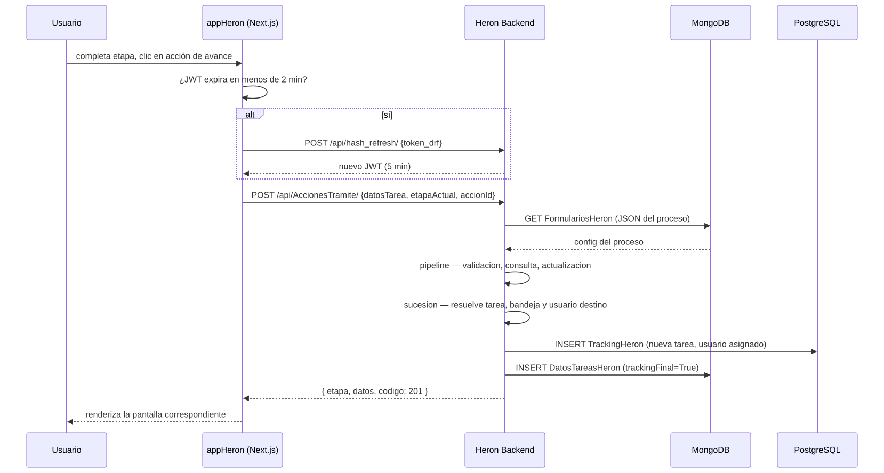
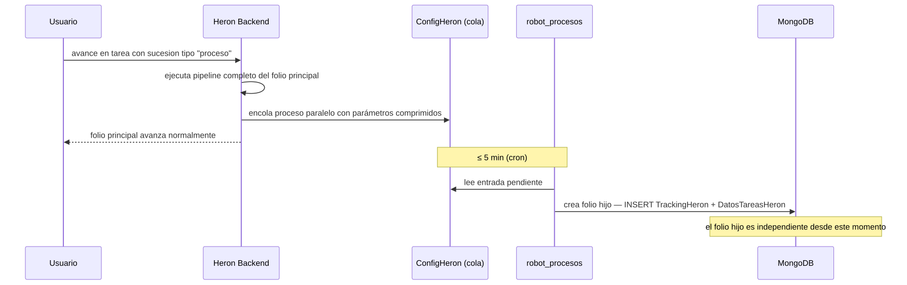
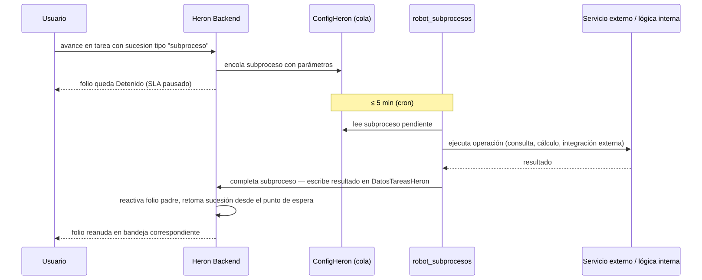

# 6. Escenarios (+1)

Los escenarios integran las cuatro vistas mediante casos de uso representativos. Cada uno describe una capacidad genérica del motor Héron, independiente de cualquier proceso o producto de negocio específico.

## Escenario 1 — Avance inter-tarea: pipeline completo y cambio de bandeja

> Un usuario confirma una etapa. El motor ejecuta el pipeline de backend, persiste el resultado y transfiere el folio a la siguiente tarea, asignándolo al responsable que corresponda.

**Capacidades ejercitadas:** renovación de JWT · `AccionesTramite` · `validacion` · `consulta` · `actualizacion` · `sucesion` · `TrackingHeron` · `DatosTareasHeron`

<!-- diagrama: diagramas/06-01-avance-inter-tarea.mmd -->

El motor crea un nuevo registro `TrackingHeron` por cada transición de tarea. El registro anterior pasa a `trackingFinal=False`; solo el registro activo tiene `trackingFinal=True`. El usuario destino se resuelve en `sucesion` mediante los valores especiales (`?usuarioCarrusel`, `?TareaProcesada`, etc.) y se verifica contra `GestionAusencias` antes de asignar.

## Escenario 2 — Bifurcación condicional en sucesión

> Al ejecutar la sucesión, el motor evalúa una condición sobre los datos del trámite y enruta el folio a uno de varios caminos posibles, cada uno con su propia tarea destino, usuario y bandeja.

**Capacidades ejercitadas:** `sucesion` · `validacionSucesion` · árbol `opciones` · `typeSucesor: "Autoriza"/"Rechaza"` · resolución de usuario por `?TareaProcesada`

El árbol `validacionSucesion` evalúa valores del `datosTarea` con el mismo mecanismo de operadores que `validacion`. Cada rama `opciones` puede declarar un `sucesor`, `usuario`, `bandeja` y `typeSucesor` distintos:

- `typeSucesor: "Autoriza"` — resuelve el siguiente nodo desde `TareasHeron.autoriza`.
- `typeSucesor: "Rechaza"` — resuelve el siguiente nodo desde `TareasHeron.rechaza`.
- `usuario: "?TareaProcesada"` — asigna el folio al mismo usuario que atendió una tarea anterior, útil en rechazos que regresan a captura.
- `usuario: null` — el folio cae a la bandeja del área sin dueño explícito.

La bifurcación puede ser tan profunda como requiera el proceso: cada opción puede a su vez contener otro `validacionSucesion`, formando un árbol de decisión evaluado en tiempo de ejecución. El detalle completo se documenta en la [Vista de Desarrollo](03-vista-desarrollo.md#sucesor).

## Escenario 3 — Proceso paralelo independiente

> Un avance de tarea dispara la creación de un folio hermano que corre en paralelo al folio principal. El folio original continúa su flujo normalmente; el proceso paralelo tiene su propio ciclo de vida, SLA y sucesión.

**Capacidades ejercitadas:** `sucesion` tipo `proceso` · `robot_procesos` · `ConfigHeron` (cola) · `NuevoTramite`

<!-- diagrama: diagramas/06-02-proceso-paralelo.mmd -->

Los parámetros se transfieren al folio hijo mediante las claves `validacionProceso` (condición de lanzamiento) y `nuevoProceso` (datos a copiar al hijo). Una vez creado, el proceso paralelo no tiene comunicación de retorno con el padre.

## Escenario 4 — Subproceso embebido con folio en espera

> Un avance de tarea dispara un subproceso que debe completarse antes de que el folio padre continúe. El folio queda en estado Detenido —con el SLA pausado— hasta que el robot termina el subproceso y lo reactiva con el resultado.

**Capacidades ejercitadas:** `sucesion` tipo `subproceso` · `robot_subprocesos` · flag `detenido` · pausa de SLA · `GestionAusencias`

<!-- diagrama: diagramas/06-03-subproceso-embebido.mmd -->

A diferencia del proceso paralelo, el subproceso devuelve su resultado al folio padre antes de que este continúe. Es el mecanismo adecuado para operaciones que bloquean el avance por diseño.

## Escenario 5 — Folio generado automáticamente por robot

> El sistema detecta una condición operativa sin intervención humana y crea un folio de trabajo mediante el mismo mecanismo que un usuario usaría desde la interfaz. El folio resultante es indistinguible de uno iniciado manualmente.

**Capacidades ejercitadas:** `robot_tramites` · `NuevoTramite` · `ConfigHeron` · `Hermes`

<!-- diagrama: diagramas/06-04-folio-automatico-robot.mmd -->

La configuración del robot vive en `ConfigHeron`. Al crear el folio, el motor ejecuta la misma lógica de inicialización que `NuevoTramite` desde la interfaz: crea el `TrackingHeron` inicial, inicializa el `DatosTareasHeron` y aplica las reglas de SLA y asignación configuradas en el proceso.

---

<!-- nav -->
<table width="100%">
<tr>
<td align="left"><a href="05-vista-fisica.md">← Anterior: Vista Física</a></td>
<td align="center"><a href="README.md">Principal</a></td>
<td align="right"><a href="07-decisiones.md">Siguiente: Decisiones →</a></td>
</tr>
</table>
