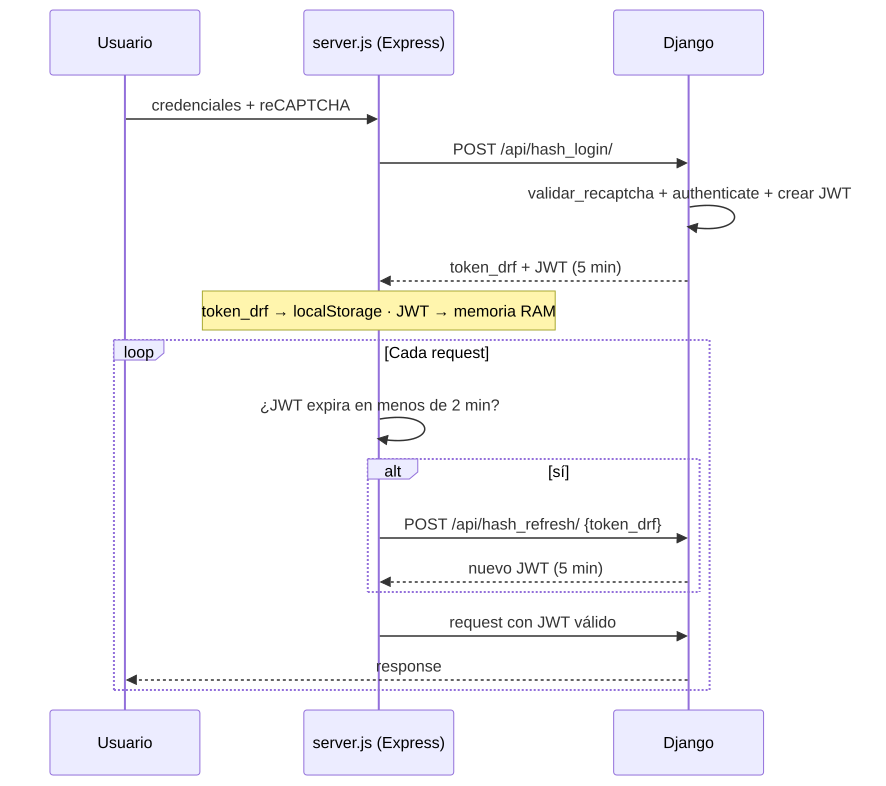
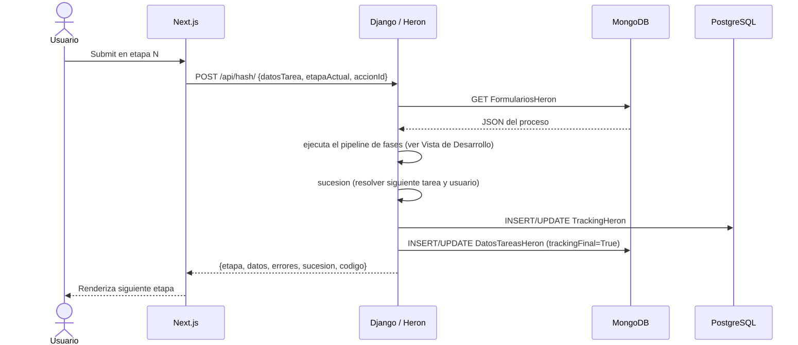
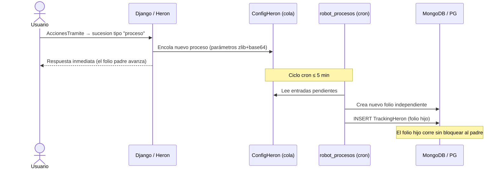
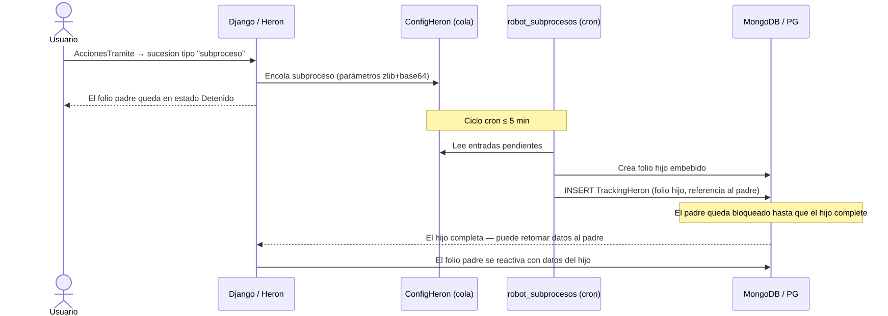

# 4. Vista de Procesos

Esta vista describe el sistema en ejecución: qué procesos del sistema operativo atienden las peticiones, cómo se autentica cada llamada, cómo transcurre el ciclo de vida de un trámite y cómo opera el motor cuando el trabajo ocurre fuera del ciclo HTTP —en robots, procesos paralelos y subprocesos.

## 4.1 Procesos en tiempo de ejecución

<!-- diagrama: ../Diagramas/04-01-procesos-runtime.mmd -->


Nginx es el punto de entrada único al sistema. Django maneja la concurrencia con múltiples workers de Gunicorn: procesos Python independientes, cada uno con su propio pool de conexiones a PostgreSQL y MongoDB. Next.js corre como proceso único bajo PM2, con reinicio automático ante fallos.

<!-- diagrama: ../Diagramas/04-02-workers-gunicorn.mmd -->


## 4.2 Autenticación JWT

<!-- diagrama: ../Diagramas/04-03-autenticacion-jwt.mmd -->


El JWT se almacena únicamente en RAM (no en `localStorage` ni cookies persistentes). El servidor Express gestiona el refresco de forma transparente antes de que expire. La autorización por rol no es un middleware centralizado: cada endpoint implementa su propia clase de autorización.

## 4.3 Ciclo de vida de un trámite

El recorrido completo de un avance de tarea, visto como secuencia de componentes, combina la ejecución del pipeline de backend con la persistencia en ambas bases de datos:

<!-- diagrama: ../Diagramas/04-04-ciclo-vida-tramite.mmd -->


El detalle de cada fase del pipeline —su orden real, la etapa sobre la que trabaja y la información que consume— se documenta en la [Vista de Desarrollo](03-vista-desarrollo.md#pipeline). Aquí interesa la mecánica de ejecución: el motor lee el JSON del proceso, ejecuta las fases configuradas, resuelve la sucesión y persiste el nuevo estado en `TrackingHeron` (PostgreSQL) y `DatosTareasHeron` (MongoDB).

Variantes relevantes en la resolución de `sucesion`:

- Si la acción tarda (generación de documentos, llamadas externas), puede quedar en cola y ser ejecutada por `robot_acciones` en el siguiente ciclo de 5 minutos.
- `sucesion` puede enrutar a una nueva tarea del mismo proceso, a un proceso paralelo independiente (`proceso`) o a un subproceso embebido (`subproceso`).
- El usuario destino se resuelve con soporte para ausencias: si el asignado tiene una ausencia activa en `GestionAusencias`, el folio se redirige automáticamente a su reemplazo configurado.
- Cada nodo de sucesión puede incluir la llave `etapaId` para forzar que el sucesor inicie en una etapa específica (por defecto `"0"`).

## 4.4 Gestión de SLA

Cada tarea de Héron puede tener un SLA en minutos. El cálculo considera exclusivamente **horas laborales** según la configuración del proceso.

**Horario laboral base:**

| Día | Horario |
|---|---|
| Lunes–Jueves | 09:00 – 18:00 |
| Viernes (y días de media jornada) | 09:00 – 15:00 |
| Sábado/Domingo y festivos | No se contabiliza |

El proceso define en su configuración:

- `dias_festivos` — lista de fechas fuera de operación.
- `media_jornada` — lista de fechas con horario corto (el viernes es automático; permite agregar, por ejemplo, el 24 de diciembre).

Las funciones de cálculo viven en `apis/Heron/tools.py`:

| Función | Propósito |
|---|---|
| `diasLaboralesTranscurridos` | Punto de entrada principal; delega según el tipo de jornada |
| `diasLaboralesTranscurridosJornadaCompleta` | Calcula minutos laborales L–J 09:00–18:00 |
| `diasLaboralesTranscurridosMediaJornada` | Calcula minutos laborales V y días `media_jornada` 09:00–15:00 |
| `getTiempoSLA` | Retorna el porcentaje de SLA restante |
| `getTiempoCompletoSLA` | Retorna datos completos de SLA (total, consumido, restante) |
| `getShortTiempoSLA` | Formato compacto para visualización en bandeja |

### Semáforo visual

Existen dos mecanismos de semáforo independientes:

| Mecanismo | Dónde | Qué mide |
|---|---|---|
| Semáforo de tarea | Dentro del folio, en la pantalla de la tarea | Tiempo restante de SLA de la tarea actual |
| `alertas_sla` | Columna de la bandeja general | Indicador de SLA para el supervisor; configura umbrales a nivel proceso |

Umbrales por defecto:

| Color | Condición |
|---|---|
| Verde | ≥ 80% del tiempo de SLA restante |
| Amarillo | Entre 20% y 80% restante |
| Rojo | < 20% restante |

### Flags de control de SLA

| Flag | Ubicación | Efecto |
|---|---|---|
| `detenido = true` | Registro `TrackingHeron` | **Pausa** el contador de SLA; el folio permanece visible pero el tiempo no avanza |
| `detenido = false` | Registro `TrackingHeron` | El tiempo avanza normalmente |
| `detenido_accion_usuario` | Configuración del proceso (`tareas`) | Lista de tareas donde el ícono de edición permanece habilitado aunque `detenido=true` |

El flag `detenido` controla **solo el SLA**; el estado visible del folio en la bandeja es independiente.

<a id="robots"></a>

## 4.5 Robots y ejecución paralela

Las operaciones largas o diferidas se resuelven fuera del ciclo HTTP mediante un sistema de robots ejecutados por cron cada **5 minutos**. Este es el mecanismo que permite que un trámite dispare trabajo sin bloquear al usuario, y que el sistema genere trabajo por sí mismo.

| Robot | Propósito |
|---|---|
| `robot_acciones` | Ejecuta las acciones (`accion`) encoladas |
| `robot_procesos` | Crea los procesos paralelos independientes (`proceso`) |
| `robot_subprocesos` | Crea los subprocesos embebidos (`subproceso`) |
| `robot_tramites` | Genera trámites automáticamente (renovaciones, recordatorios) |

La cola del robot de acciones vive en el documento `Robot Acciones` dentro de la colección `ConfigHeron` (llave `"Pendientes"`, arreglo de entradas con parámetros comprimidos). No es una tabla de PostgreSQL. Cada robot tiene su propio registro de cola en `ConfigHeron` (`Robot Procesos`, `Robot SubProcesos`, `Robot Trámites`).

Los parámetros de cada entrada en cola se serializan como JSON comprimido con `zlib` y codificado en `base64`. El robot intenta ejecutar cada acción hasta **3 veces**; si agota los reintentos, la entrada permanece en la cola con un flag de error para diagnóstico manual.

Para depurar una entrada en cola:

```python
import zlib, base64, json
params = json.loads(zlib.decompress(base64.b64decode(encoded_param)))
```

### Proceso paralelo independiente (`proceso`)

<!-- diagrama: ../Diagramas/04-05-proceso-paralelo.mmd -->


El folio hijo tiene su propio ciclo de vida y no bloquea la continuación del folio padre. La sub-clave `nuevoProceso` en el JSON de `sucesion` define los datos que se transfieren al proceso hijo; `validacionProceso` controla si se lanza o no.

### Subproceso embebido (`subproceso`)

<!-- diagrama: ../Diagramas/04-06-subproceso-embebido.mmd -->


A diferencia del proceso paralelo, el folio padre **queda bloqueado** (estado Detenido) hasta que el subproceso termine. El subproceso puede retornar datos al padre, lo que permite usarlo para validaciones externas que toman tiempo —PLD, aprobaciones de terceros.

Ambas variantes solo están disponibles desde `AccionesTramite`; `AccionesEtapa` no las ejecuta. La resolución de `proceso`, `subproceso` y de la acción especial `repetir` se detalla en la [Vista de Desarrollo](03-vista-desarrollo.md#sucesor).

---

<!-- nav -->
<table width="100%">
<tr>
<td align="left"><a href="03-vista-desarrollo.md">← Anterior: Vista de Desarrollo</a></td>
<td align="center"><a href="../../../README.md">Principal</a></td>
<td align="right"><a href="05-vista-fisica.md">Siguiente: Vista Física →</a></td>
</tr>
</table>
