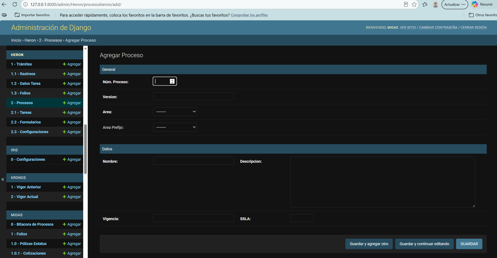
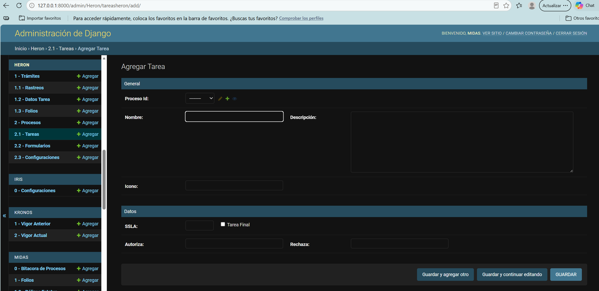

# Playbook de Implementación de Flujos de Trabajo en Héron
## Configuración de procesos, tareas, permisos y visibilidad operativa

Este playbook explica cada llave del JSON de un flujo (para qué sirve y cómo funciona). Los ejemplos completos se entregan como archivos `.json` en la carpeta `../EjemplosFlujo/` para copiarlos y editarlos directamente; cuando una sección describe una estructura, se indica el archivo que la contiene íntegra.

Para el contexto arquitectónico completo consulta la [Arquitectura 4+1](../../../README.md); este playbook se enfoca en la implementación operativa de un flujo. El detalle de las fases del pipeline está en la [Vista de Desarrollo · pipeline](03-vista-desarrollo.md#pipeline) y la estructura de condiciones (if / elif / switch con su comparación en Python) en la [Vista de Desarrollo · árbol de condiciones](03-vista-desarrollo.md#condiciones).

> **Recursos adjuntos de este playbook:**
>
> | Adjunto | Contenido |
> |---|---|
> | `../EjemplosFlujo/01-proceso-revision-documental.json` | Documento completo de la Tarea 1 (Captura): `frontend` + `backend` (validacion, actualizacion, sucesion) |
> | `../EjemplosFlujo/02-tarea-autorizacion-sucesion.json` | Tarea de Autorización: bifurcación autoriza/rechaza y cierre del trámite |
> | `../EjemplosFlujo/03-configheron-accesos.json` | Documento `ConfigHeron "Accesos"` que da visibilidad al proceso |
> | `../EjemplosFlujo/07-configheron-comentarios.json` | Documento `ConfigHeron "Comentarios"`: comentario obligatorio para autorizar/rechazar |
> | `../EjemplosFlujo/04-validacion-opciones.json` | Árbol `camposValidaciones` con `operador~alias`, `opciones` y comodín `*` |
> | `../EjemplosFlujo/05-formulario-fields-inputs.json` | Formulario completo con `fields`: filas, inputs de texto/select/fecha/checkbox, `modifier`/`config`, `query` |
> | `../EjemplosFlujo/06-etapa-forms-typeform.json` | Lista `forms` de una etapa combinando varios `typeForm` (Formulario, Domicilio, Select, Lista, Visualizador, Tabla) |
> | `../Inventarios/heron-inventario-funciones-apis.xlsx` | Inventario de las 1,156 funciones de backend invocables por el JSON, una hoja por catálogo/API |
> | `../Inventarios/heron-inventario-componentes-frontend.xlsx` | Inventario de los componentes frontend: `typeForm` montables, tipos de input, llaves/variantes de input y componentes generales |

---

## 1. Propósito del playbook

Héron es el motor de workflow sobre el que opera MIDAS 2.0. Su premisa de diseño es que **un trámite se define por configuración, no por código**: las pantallas, validaciones, transiciones, permisos y elementos visibles se describen como documentos JSON en MongoDB (más un pequeño grafo relacional en PostgreSQL) que el core interpreta en tiempo de ejecución. Cambiar un proceso es editar un documento, no desplegar una versión nueva del backend.

Este playbook guía a un desarrollador —que puede no conocer Héron— desde el **requerimiento de negocio** hasta un **flujo operativo y visible en la plataforma**. No se limita a listar llaves: explica *por qué* se configura cada elemento, *qué impacto* tiene, *cómo validarlo* y *dónde está el código* que lo interpreta cuando algo no se comporta como se espera.

El resultado esperado, al terminar de aplicarlo, es saber traducir un requerimiento en: un proceso, sus tareas, sus pasos, las áreas participantes, la matriz de permisos, el enlace entre tareas, la visibilidad en el menú y una validación funcional de punta a punta.

---

## 2. Alcance del playbook

**Cubre:**

- Análisis del requerimiento y su descomposición en proceso / tareas / pasos / áreas.
- Registro del proceso y sus tareas (PostgreSQL: `ProcesosHeron`, `TareasHeron`).
- Configuración del documento JSON del proceso (MongoDB: `FormulariosHeron`): frontend por rol y backend por fases.
- Configuración de permisos por área, rol y usuario (clases de autenticación + colección `ConfigHeron`).
- Enlace entre tareas (`sucesion`) y entre procesos (`proceso`, `subproceso`, `repetir`).
- Visibilidad en menú, "Nuevo Trámite", bandejas y barra de navegación.
- Validación funcional y rastreo de código para depurar.
- Reglas de nombrado y orden de precedencia de configuraciones.

**No cubre** (y no debe asumirse):

- Cambios estructurales al core (nuevos modelos, migraciones de esquema), salvo que el requerimiento lo exija de forma demostrable.
- La implementación de **funciones de negocio nuevas** en los catálogos de Python (cotizadores, generación de documentos, registros en MIDAS). El playbook explica cómo *invocarlas* desde el JSON y cómo *verificar* que existen; crearlas es una tarea de backend aparte.
- La creación de **componentes React nuevos** en la librería `frontend/components`. El playbook explica cómo *configurar* los componentes existentes desde el JSON (`typeForm`, `fields`, inputs) y cuál elegir en cada caso; desarrollar componentes nuevos es una tarea de frontend aparte.

---

## 3. Conceptos base de Héron

Antes de configurar conviene fijar el vocabulario. La columna "Llave / entidad" indica la correspondencia directa con el JSON o el modelo cuando existe.

| Concepto | Qué es | Llave / entidad |
|---|---|---|
| **Proceso** | La plantilla completa de un trámite (el grafo de tareas). | `ProcesosHeron` (PostgreSQL) + documento en `FormulariosHeron` (MongoDB) |
| **Tarea** | Un nodo del grafo del proceso; una "estación de trabajo". | `TareasHeron` (PostgreSQL) |
| **Etapa** | Una pantalla dentro de una tarea. Una tarea es un mini-grafo de etapas. | Llaves de `frontend.etapas` (`"0.0"`, `"0.1"`, …) |
| **Paso** | Sinónimo operativo de etapa; el avance de una pantalla a la siguiente. | Botones `submitFormValid` / `submitEtapa` |
| **Estado / estatus** | La situación del folio (nuevo, procesando, detenido, completado…). | `TrackingHeron.estatus` → catálogo `ESTATUS_TRAMITE` |
| **Folio** | Una instancia viva de un proceso (un trámite concreto). | `TramitesHeron` + `TrackingHeron` |
| **Área** | Departamento responsable; determina la bandeja. | `ProcesosHeron.area` → catálogo `AREAS` |
| **Bandeja** | Cola de trabajo de un área o usuario. | `TrackingHeron.bandeja` |
| **Rol** | Perfil del usuario; decide qué vista y qué permisos recibe. | `Usuarios.idRol` → catálogo `ROLES` |
| **Flujo** | El recorrido completo del folio entre tareas. | `sucesion` + `TareasHeron.autoriza`/`rechaza` |
| **Menú / barra de navegación** | Navegación superior del portal. | `ConfigHeron` doc `"Barra Navegación"` |
| **Alias** | Nombre visual alterno de una etapa/tarea, definido en datos. | `aliasTramite` escrito en `datosTarea` por la fase `actualizacion` |
| **Variante de frontend** | La vista servida según rol/área/usuario. | `frontend`, `frontendSupervisor`, `frontendAgente`, … |
| **Fase (backend)** | Cada paso del pipeline de servidor. | `validacion`, `actualizacion`, `sucesion`, … |
| **`accionId`** | El identificador del botón; llave bajo la que vive la lógica de backend. | `backend[accionId][fase][etapa]` |

Tres dependencias que conviene interiorizar desde el inicio, porque son la causa más común de que "no aparezca nada":

1. **Proceso + Tarea + Formulario van de la mano.** Aunque una pantalla esté perfectamente configurada en `FormulariosHeron`, no se renderiza si no existe el par proceso/tarea en PostgreSQL. Y a la inversa: un nodo del grafo sin su documento JSON no se puede atender.
2. **`frontend` cambia la vista; `backend` es compartido.** Las variantes por rol solo cambian lo que el usuario ve. La lógica de servidor (`backend`) es única para todos los roles y actúa como segunda línea de validación.
3. **La visibilidad no vive en el JSON del proceso, sino en `ConfigHeron`.** Que un trámite aparezca en el menú "Nuevo Trámite" o en una bandeja se controla en documentos separados de la colección `ConfigHeron` (sección 10).

---

## 4. Lectura inicial del requerimiento

El primer trabajo no es técnico: es descomponer el requerimiento en las piezas que Héron sabe representar. La siguiente tabla es la lista de preguntas guía que conviene responder **antes** de tocar una sola llave.

| Elemento a identificar | Pregunta guía | Resultado esperado |
|---|---|---|
| Proceso | ¿Qué flujo de negocio se quiere operar de principio a fin? | Nombre y área dueña del proceso |
| Tareas | ¿Qué acciones distintas ejecuta cada área sobre el folio? | Lista de nodos del grafo |
| Áreas | ¿Quién interviene en cada tarea? | Áreas / bandejas participantes |
| Pasos (etapas) | ¿Cuántas pantallas necesita cada tarea? | Etapas por tarea |
| Entradas/salidas | ¿Qué datos entran y qué datos produce cada tarea? | Formularios (`refForm`) por etapa |
| Transiciones | ¿Cuándo avanza, cuándo se rechaza, cuándo se cierra? | `autoriza` / `rechaza` por tarea |
| Permisos | ¿Quién puede ver, editar, avanzar o cerrar? | Matriz de permisos (sección 8) |
| Menú | ¿Dónde debe aparecer y quién puede iniciarlo? | Entrada en `ConfigHeron "Accesos"` |

Un buen criterio para separar tareas: **cada cambio de área o de responsable es una tarea nueva.** Si el mismo usuario captura tres pantallas seguidas, eso es una sola tarea con tres etapas. Si al terminar el folio pasa a otra área para revisión, ahí empieza una segunda tarea.

---

## 5. Ejemplo base de implementación

A lo largo del playbook usaremos un flujo realista y autónomo, no atado a ningún proceso de producción existente:

> **Solicitud de Revisión Documental.** El área **Comercial** registra convenios nuevos que requieren revisión legal. Comercial **captura** los datos del convenio y adjunta la documentación. El área **Legal** **revisa** y valida los documentos. Un **Jefe de Área** **autoriza** o **rechaza**. Si se rechaza, el folio regresa a Comercial para corrección; si se autoriza, el trámite se **completa**.

Descomposición:

<!-- diagrama: ../Diagramas/08-01-descomposicion-ejemplo.mmd -->


| Tarea | `tareaId` | Área / bandeja | Rol que la atiende |
|---|---|---|---|
| Captura | `11-40-1.0-1` | Comercial (11) | Empleado |
| Revisión Legal | `11-40-1.0-2` | Legal (5) | Empleado |
| Autorización | `11-40-1.0-3` | Comercial (11) | Jefe de Área |
| Completado | `11-40-1.0-8` | — | terminal |
| Cancelado | `11-40-1.0-9` | — | terminal |

> El número de proceso (`40`) es un consecutivo de ejemplo; en la práctica se solicita el siguiente disponible. La versión siempre inicia en `1.0`.

---

## 6. Configuración del proceso

El proceso se registra en **PostgreSQL** (`ProcesosHeron`) y su definición de pantallas/lógica en **MongoDB** (`FormulariosHeron`). Esta sección cubre la parte relacional; la sección 7 cubre las tareas y la 7-9 el JSON.

### 6.1 Modelo `ProcesosHeron`

Campos reales del modelo (`backend/apis/Heron/models.py:21-47`):

| Llave JSON / campo | Propósito | Oblig./Opc. | Valores posibles | Orden / precedencia | Ejemplo | Consideraciones |
|---|---|---|---|---|---|---|
| `procesoId` | Identificador único (PK). Se compone de los otros campos. | Obligatoria | `{area}-{numProceso}-{version}` | Se deriva; no se inventa a mano | `11-40-1.0` | Formato **numérico**, no un slug. Cambiar la versión crea un proceso nuevo |
| `numProceso` | Consecutivo del proceso dentro del área. | Obligatoria | Entero | — | `40` | Solicitar el siguiente disponible del área |
| `version` | Versión del proceso. | Obligatoria | `1.0`, `1.1`, … | Ver §6.3 versionamiento | `1.0` | Siempre inicia en `1.0` |
| `area` | Área dueña del proceso. | Obligatoria | Catálogo `AREAS` | — | `11` (Comercial) | Define en qué área aparece el trámite |
| `areaPrefijo` | Prefijo de folio (tipo de folio). | Opcional | Catálogo `AREA_FOLIOS` | default `None` | `11` | Superset de `AREAS`; añade tipos como Dictámenes (36) |
| `nombre` | Nombre legible del proceso. | Obligatoria | Texto | — | `Solicitud de Revisión Documental` | Es el que ve el usuario en "Nuevo Trámite" |
| `descripcion` | Descripción larga. | Opcional | Texto | — | — | — |
| `vigencia` | Controla si el proceso está activo. | Obligatoria | `"0"` = inactivo; otro = vigente | — | `"1"` | **Un proceso con `vigencia="0"` no aparece** (ver §10) |
| `ssla` | SLA global del proceso, en minutos. | Obligatoria | Entero | Ver advertencia | `4320` | La suma de SLA de las tareas no debe exceder este valor o el semáforo saldrá rojo (§7.4) |

```python
# Registro del proceso — Django shell o migración de datos
from apis.Heron.models import ProcesosHeron

ProcesosHeron.objects.create(
    numProceso  = 40,
    version     = "1.0",
    area        = 11,                               # Comercial
    areaPrefijo = 11,
    nombre      = "Solicitud de Revisión Documental",
    descripcion = "Revisión legal de convenios comerciales.",
    vigencia    = "1",
    ssla        = 4320,                             # 3 días hábiles (72 h * 60)
)
# procesoId se compone como "11-40-1.0"
```

Los mismos campos se pueden capturar desde el panel de administración de Django (`/admin/Heron/procesosheron/add/`):



> **Advertencia (afecta a todos los folios del proceso):** no elimines ni cambies la `vigencia` de un proceso con folios en curso. El versionamiento correcto (§6.3) es dar de alta la versión nueva, quitar acceso a la anterior y dejar que sus folios terminen.

### 6.2 Documento JSON del proceso (MongoDB)

Cada **tarea** tiene su documento en `FormulariosHeron`. La estructura de primer nivel:

```json
{
  "title": "captura - Solicitud de Revisión Documental",
  "frontend": { "etapas": {} },
  "backend":  {},
  "consulta": {},
  "bitacora": {}
}
```

| Llave | Propósito | Consideraciones |
|---|---|---|
| `title` | Etiqueta de seguimiento humano. **No es funcional.** | Estándar del equipo: `"{tarea} - {proceso}"`. El core no la usa para nada |
| `frontend` | Las pantallas (variante base). Contiene `etapas`. | Puede convivir con variantes por rol (`frontendSupervisor`, etc.) |
| `backend` | Toda la lógica de servidor, organizada por `accionId`. | **Compartida entre todos los roles** |
| `consulta` | Consultas globales del proceso. | Distinta del `consulta` que vive dentro de cada fase de una etapa |
| `bitacora` | Configuración de bitácora/auditoría. | — |

> Para procesos cuyo JSON supera el límite práctico de MongoDB (~25–35 MB), el core guarda el fragmento excedente como archivo en disco y lo re-ensambla en RAM al ejecutar. Es transparente; solo relevante para procesos muy grandes.

### 6.3 Versionamiento (crítico)

Los folios **nacen con la versión del proceso vigente en ese momento** y la conservan hasta cerrarse. Esto permite evolucionar procesos sin romper folios en vuelo:

- Al **agregar o quitar un nodo** del grafo, sube la versión (`1.0` → `1.1`). Si reusas la misma versión, los folios existentes "no tienen el mismo par" tarea/formulario y truenan.
- Procedimiento seguro: das de alta la versión nueva, **quitas acceso** a la anterior (§10) y habilitas la nueva. La anterior sigue operando hasta que se finalicen sus folios.
- Para forzar el paso de folios de una versión a otra existe el endpoint **`APIMigrarFoliosVersion`** (`apiGeneral.py`, hash `806ab36ef2d309ae0db49ef6bd107d07`). Recibe `folios`, `procesoId` (nuevo), `procesoIdAnterior` y opcionalmente los mapeos `nuevaTarea` y `nuevoAlias`. Reasigna el `procesoId` del trámite y **reconstruye los registros de `TrackingHeron`** aplicando el mapeo de tareas. **No** migra los `DatosTareasHeron` de MongoDB; los datos capturados se conservan tal cual.
- El versionamiento de **reglas de negocio** (p. ej. tarifas por año) es distinto: se pasa un parámetro (`"tarifas 2026"`) y el core extrae la configuración del año, de modo que trámites históricos conservan sus reglas. Las reglas de negocio se agregan al JSON conforme el trámite lo requiere; las funciones configuradas deben implementar la lógica de recibir los parámetros correspondientes para ejecutar la regla de negocio programada.

---

## 7. Configuración de tareas

### 7.1 Modelo `TareasHeron`

Campos reales (`backend/apis/Heron/models.py:50-81`):

| Llave JSON / campo | Propósito | Valores posibles | Ejemplo | Impacto en plataforma |
|---|---|---|---|---|
| `tareaId` | Identificador único (PK). | `{procesoId}-{numTarea}` | `11-40-1.0-1` | Es el nodo del grafo |
| `procesoId` | FK al proceso. | procesoId existente | `11-40-1.0` | Asocia la tarea al proceso |
| `numTarea` | Consecutivo de la tarea. | Entero | `1` | Compone el `tareaId` |
| `nombre` | Nombre legible. | Texto | `Captura de convenio` | Se ve en bandeja/tracking |
| `descripcion` | Descripción. | Texto | — | — |
| `icono` | Ícono de la tarea. | Texto (clase de ícono) | `"bi-file-earmark"` | Se muestra en la UI |
| `autoriza` | Lista de tareas sucesoras del camino "aprobar". | tareaIds separados por coma | `"2"` o `"2,3"` | Destinos posibles al autorizar |
| `rechaza` | Lista de tareas sucesoras del camino "rechazar". | tareaIds separados por coma | `"1"` | Destinos posibles al rechazar |
| `ssla` | SLA de la tarea, en minutos. | Entero | `1440` | Alimenta el semáforo de la tarea |
| `tareaFinal` | Marca de nodo terminal. | `True` / `False` | `False` | Si `True`, el folio cierra (completado o cancelado) |

> **Importante — dónde viven ciertos campos.** `TareasHeron` **no** tiene `area`, `bandeja` ni `aliasTramite`. El `area` vive en `ProcesosHeron`. La **`bandeja` de destino se asigna en la `sucesion`** (cada opción declara su `bandeja`). El `aliasTarea` se escribe en `TrackingHeron` / `datosTarea` en tiempo de ejecución.

```python
from apis.Heron.models import TareasHeron, ProcesosHeron
proc = ProcesosHeron.objects.get(procesoId="11-40-1.0")

TareasHeron.objects.create(numTarea=1, procesoId=proc, nombre="Captura de convenio",
    icono="bi-file-earmark", autoriza="2", rechaza="9", ssla=1440, tareaFinal=False)

TareasHeron.objects.create(numTarea=2, procesoId=proc, nombre="Revisión Legal",
    icono="bi-search", autoriza="3", rechaza="1", ssla=960, tareaFinal=False)

TareasHeron.objects.create(numTarea=3, procesoId=proc, nombre="Autorización",
    icono="bi-check2-circle", autoriza="8", rechaza="1", ssla=480, tareaFinal=False)

TareasHeron.objects.create(numTarea=8, procesoId=proc, nombre="Completado",
    autoriza="", rechaza="", ssla=0, tareaFinal=True)

TareasHeron.objects.create(numTarea=9, procesoId=proc, nombre="Cancelado",
    autoriza="", rechaza="", ssla=0, tareaFinal=True)
```

Cada tarea también puede darse de alta desde el panel de administración (`/admin/Heron/tareasheron/add/`), donde se ven los campos `Proceso Id`, `Nombre`, `Icono`, `SSLA`, `Tarea Final`, `Autoriza` y `Rechaza`:



### 7.2 Etapas: el mini-grafo de una tarea

Dentro de cada tarea, `frontend.etapas` es un diccionario de pantallas. Convención del equipo (no obligación del core):

- Todo **inicia en `"0"` o `"0.0"`**.
- **IDs enteros** (`0`, `1`, `2`) para pantallas simples y lineales.
- **IDs decimales** (`0.01`, `0.02`) para agrupar variantes de una misma pantalla lógica (p. ej. persona física vs. moral).

La única llave que **debe** existir en toda variante de frontend es `etapas`.

### 7.3 Estructura de una etapa (frontend)

> **Ejemplo completo:** adjunto `01-proceso-revision-documental.json` (bloque `frontend.etapas`). Aquí se explica cada llave.

El backend nunca envía todo el dict `etapas`: resuelve `jsonFormulario[frontendId]["etapas"][etapaActual]` y entrega **solo la etapa en curso**. Las llaves de una etapa:

| Llave | Tipo | Para qué sirve / cómo funciona |
|---|---|---|
| `title` | String | Título visible de la pantalla (`<h1>`). Recomendada: si falta, el encabezado queda vacío |
| `style` | String | Variante visual; se concatena a las clases CSS (`button`+style, etc.). `"HIR"` es la marca por defecto |
| `ruta` | **Objeto (dict)** | Breadcrumb. Las llaves son IDs de etapa y el valor la etiqueta a mostrar. **No es un arreglo.** Se recorre con `for key in ruta`: una llave que empieza con `"*"` se pinta como ítem especial; el ítem se marca **activo** cuando `etapaId == key`. Un valor vacío no se pinta. Es solo visual — la liga no navega |
| `buttons` | Objeto | Botones de acción (ver abajo) |
| `forms` | Lista | Componentes/formularios que componen el cuerpo (ver abajo) |

**Estructura de un botón.** Propiedades: `variant`, `name`, `type`, `action`, `ref`, `message`, `options`.

| Llave | Para qué sirve |
|---|---|
| `name` | Etiqueta visible **y** `accionId` por defecto. Valor reservado `"Limpiar"`: limpia el form localmente sin enviar |
| `ref` | Si existe, es el `accionId` que se envía (desacopla la acción del texto). **`accionId = ref ?? name`** |
| `type` | Qué hace el botón (ver tabla de tipos) |
| `action` | La **URL del endpoint** al que se envía (`url = urlServer + action`). Para `type:"function"` es una función JS que se invoca. **`action` no es el `accionId`** |
| `message` | Texto del loader mientras procesa |
| `variant` | `"Dropdown"` lo dibuja como menú con `options[]` (cada opción es un botón con la misma forma); ausente = botón simple |

> Conexión frontend↔backend: el motor busca `backend[accionId][fase][etapa]` usando el `accionId` resuelto (`ref ?? name`). El `action` solo decide **a qué endpoint** se envía (por eso determina si corre `AccionesEtapa` o `AccionesTramite`).

**Tipos de botón** (`button.type`, con su alias legado):

| `type` | Alias | Descripción |
|---|---|---|
| `submitFormValid` | `url` | Valida los forms y envía; dispara el pipeline y avanza |
| `submitEtapa` | `url2` | Navega a otra etapa **sin** enviar datos (`listaForms` vacío) |
| `submitForm` | `url3` | Envía **sin** correr la validación de forms (no existe en `TramitePaginacion`) |
| `submitSave` | `save` | Guardado parcial sin avanzar |
| `function` | — | Ejecuta `button.action()` en el cliente (sin fetch) |

**Las 5 llaves obligatorias de cada `form`** (más `datosIniciales`, que inyecta el backend):

| Llave | Tipo | Para qué sirve / cómo funciona |
|---|---|---|
| `typeForm` | String | Componente React a renderizar (PascalCase, case-sensitive en el `switch`). Si no está en el switch, el form no se pinta ni se lee |
| `blockForm` | Boolean | `true` = bloquea la UI **y** el backend **no lee** ese form (no aporta datos al payload). Distinto de `readOnly` |
| `validForm` | Boolean | `true` = el form participa en la validación previa a `submitFormValid` (se le pide `validarForm()`) |
| `refForm` | String | Llave bajo la que se agrupan los datos en `datosTarea`. **Debe coincidir exacto** con el `nombreFormulario` que el backend usa en validacion/actualizacion/consulta. Conviene segmentar por entidad (una llave para la póliza, otra para el contratante, otra para los agentes): facilita invocar funciones y evita que los datos "se revuelvan" |
| `propsForm` | Object | Props adicionales que se esparcen (`{...propsForm}`) sobre el componente hijo (labels, catálogos, columnas, etc.) |
| `datosIniciales` | Object | **No se declara**: el backend lo inyecta por `refForm` con los datos ya capturados para precargar el form |

> `blockForm` vs `readOnly`: en el contenedor del trámite **no existe** una llave `readOnly` a nivel de form; la que gobierna el bloqueo es `blockForm`. `readOnly` puede existir como prop interna del componente (dentro de `propsForm`), y solo bloquea visualmente —el backend **sí** recibiría el valor—, mientras que `blockForm=true` bloquea la UI **y** el backend ignora el valor.

> **Códigos de respuesta.** En las validaciones el core solo interpreta **`201`** (éxito: avanza y **no** muestra el `mensaje`) y **`400`** (error: detiene y **sí** muestra el `mensaje`). No inventes otros códigos.

**Estructura interna de un formulario (`fields` e inputs).** Los campos de un componente `Formulario` viven en `propsForm.fields`, un dict cuyas llaves son **números de fila** (se ordenan numéricamente; no tienen que ser consecutivos — `{"0","1","3"}` es válido). Cada fila es a su vez un dict de inputs donde **la llave es la etiqueta visible del campo** (se usa como placeholder/label) y el valor es la configuración del input:

> **Ejemplo completo:** adjunto `05-formulario-fields-inputs.json`. Los ~95 tipos de input y todas las llaves de `modifier` están en el Excel de componentes (hojas *Tipos de input* y *Llaves y variantes de input*).

| Llave del input | Para qué sirve / cómo funciona |
|---|---|
| `ref` | Identificador interno: llave bajo la cual se **lee el dato inicial** (`datosIniciales[ref]`) y se **envía el valor** al backend. Obligatoria |
| `type` | Tipo de control. Decide el render, la validación por tecla y al enviar, y el formateo del valor. Hay ~95 tipos: genéricos (`text`, `textArea`, `select`, `date`, `checkBox`, `switch`, `file`…), numéricos (`int`, `float`, `dinero`, `porcentaje`…), de dominio con validación propia (`rfc`, `curp`, `email`, `telefono`, `codigoPostal`, `poliza`…) y de catálogo servido por el backend (`pais`, `ocupacion`, `agentes`, `catalogoServer`…). Un `type` que contenga `file` viaja como **documento**, no como valor |
| `variant` | Envoltorio visual del input: `Input` (control pelado), `InputGroup` (etiqueta a la izquierda), `InputGroupAlert`, `InputGroupIcon`, `InputMenusIcons`, `InputClassic` (label arriba, default), `InputQuiz` |
| `modifier` | Parámetros de la **lógica** del componente. Aquí van las **opciones de un `select`** (`options`, lista de strings; en `selectObject`, objetos `{ref, name}` para que el usuario vea un texto y el backend reciba otro valor), los límites `min`/`max` con sus `errorMin`/`errorMax`, `contextOptions` (opciones dependientes de otro campo), `catalogo` (para `catalogoServer`), `optional`, `clearButton`, `icon`… Sin `modifier.options`, un `select` solo muestra el placeholder y nunca valida |
| `config` | Atributos que llegan **directo al HTML nativo** (spread sobre el control): `maxLength`, `placeholder`, `min`/`max` de fecha, `autoComplete`, `inputmode`… El contenedor además inyecta aquí `readOnly` y `onBlur` en tiempo de ejecución |
| `value` | Valor por defecto cuando **no** hay dato inicial para su `ref` |
| `errormessage` | Mensaje mostrado cuando el valor es inválido (default "Valor invalido.") |
| `valid` | Opt-out de validación: **todo campo se valida por defecto**; solo `"valid": false` explícito lo exenta |
| `block` | Bloqueo real: se muestra readOnly **y su valor no se envía** al backend |
| `readOnly` | Solo lectura visual, pero el valor **sí** se envía (a diferencia de `block`) |
| `blockValue` | Bloqueo condicional: readOnly **solo si el campo ya trae valor**; si está vacío, editable |
| `deleteData` | Si el campo queda vacío al enviar, manda el centinela de borrado para **eliminar** el dato previo de `datosTarea` |
| `query` | Conecta el campo con una **consulta del backend** (`backend.consulta`): al perder el foco, dispara la consulta con el valor capturado. El valor es el nombre de la consulta |
| `filterFormsId` | Conecta el campo con un **filtro** (`backend.filtro`): al cambiar, filtra/repuebla otros formularios de la etapa |

El layout de las filas lo controla `propsForm.variant` del **formulario** (no confundir con el `variant` de cada input): `Row`/`Column`, y para filas de exactamente 2 campos, `Row2`–`Row5` reparten anchos asimétricos (`Row5` = tamaño libre).

> Los datos que una consulta devuelve solo se pintan si sus llaves **coinciden literal** con los `ref` de los inputs: el frontend descarta lo que no existe en sus campos, sin error. Es la contraparte frontend de la regla de coincidencia de `refForm`.

**Tipos de formulario (`typeForm`, PascalCase).** El contenedor del trámite resuelve el `typeForm` con un `switch` case-sensitive: si el valor no coincide con un case, el form **no se pinta ni se lee**, sin error visible. El inventario completo con las props de cada uno está en el adjunto `../Inventarios/heron-inventario-componentes-frontend.xlsx` (hoja *Componentes typeForm*); el adjunto `../EjemplosFlujo/06-etapa-forms-typeform.json` muestra una etapa combinando varios y la carpeta [`EjemplosBase/FormulariosFrontend/`](../EjemplosBase/FormulariosFrontend/) trae **un ejemplo por cada `typeForm`** (con sus tipos de input). Guía de selección:

| `typeForm` | Cuándo elegirlo | `url` | Notas |
|---|---|---|---|
| `Formulario` | Captura estándar: inputs definidos en `propsForm.fields` | No | El componente base; ver estructura de `fields` abajo |
| `FormularioDinamico` | La estructura cambia según un campo (física/moral). Resuelve **en local**, sin round-trip | No | Las llaves de opción deben coincidir **literal** con las del bloque |
| `FormularioFiltro` | Igual que el dinámico pero las combinaciones son enormes: **consulta al backend** (variante `frontendConfig`) qué renderizar | **Sí** | Para "borrar" un campo: quítalo del `default`, no de la combinación |
| `FormularioArchivos` | Carga de documentos con restricciones de tipo/nombre/tamaño | No | `accept` (default `['pdf']`), `namesAccept` (regex), `maxSize`. Se re-monta con cada respuesta |
| `FormularioMultiple` | N instancias del mismo set de forms en **pestañas** (agregar/quitar) | No | `type` (nombre de pestaña), `max` (default 4), `iconAdd`/`iconRest` — sin ícono el botón "se pierde" visualmente |
| `FormularioLista` | N instancias en **acordeones**; mejor para muchas instancias | No | `min`/`max`, `copyData`; `datosDefault` (llave del form) prellena cada instancia nueva |
| `FormularioTabs` | Pestañas **fijas** nombradas con los mismos sub-forms | No | `tabs`, `nameTabDocuments` (regex por pestaña) |
| `FormularioTabla` | Registros agregados/editados en modal y listados en tabla | No | `headers`, `form` (formulario por fila), `min`, filtro local |
| `FormularioCondicional` | Al cambiar un campo condicionante, **pide al backend** los sub-forms a mostrar | **Sí** | `type`: `Individual`/`Group` |
| `FormularioSelect` | Opciones donde cada una despliega su propio formulario servido por el backend | **Sí** | Requiere `propsForm.selectFormsId`; `minSelectedOptions`, `optionalOptions` |
| `FormularioCoberturas` | Configurador de coberturas con resumen tabulado | **Sí** | Solo disponible en `Tramite.js` |
| `FormularioConsulta` | Llenar forms anidados con el resultado de una consulta | **Sí** | `datosConsulta`, `dataRetained` |
| `FormularioConsultaTabla` | Buscar registros en el servidor y seleccionar un subconjunto | **Sí** | Solo disponible en `Tramite.js`; `min`/`max` de selección |
| `FormularioVisualizador` | Captura + visor de documento lado a lado | **Sí** | La `url` es la fuente del documento |
| `VisualizadorDocumentos` | Ver/descargar/validar los documentos del folio | **Sí** | `valid` (checklist de validación), `remove`+`namesDelete`, `vigencia`. También renderiza la llave `templates` |
| `Tabla` | Tabla de **solo lectura** (ordenable, paginada) | No | `datosIniciales` = `{header, body}`; `numRows` es llave del form. Nunca se envía al backend |
| `DatosPersonales` · `Domicilio` · `Cuestionario` · `RegistroBeneficiarios` | Formularios prehechos de dominio (campos fijos estándar) | No | Serializan directo y **no** pueden aportar archivos |
| `Paginas` | Divide la etapa en páginas (p. ej. certificados de grupo) | No | **Solo** en `TramitePaginacion.js`; `datosIniciales` = `{numeroPaginas, paginaActual}` |

Tres reglas transversales:

- **Anidamiento recursivo.** `FormularioMultiple`, `FormularioTabs`, `FormularioLista`, `FormularioTabla`, `FormularioCondicional`, `FormularioConsulta`, `FormularioSelect`, `FormularioCoberturas` y `FormularioVisualizador` aceptan a su vez listas de `forms` con los mismos `typeForm`: el patrón de configuración es el mismo en cualquier profundidad, hasta llegar a un `fields`.
- **Dinámicos vs. directos.** Los `Formulario*` son "dinámicos": devuelven `{valores, documentos}` y sus archivos `File` viajan en el FormData. Los prehechos (`DatosPersonales`, `Domicilio`, `Cuestionario`, `RegistroBeneficiarios`) y `VisualizadorDocumentos` serializan su objeto directo y no aportan archivos. `Tabla` (y `Paginas`) están **excluidos** del envío.
- **Llaves opcionales a nivel del form** (hermanas de `propsForm`): `url` (solo componentes con conexión al backend; se concatena a la URL del servidor), `datosDefault` (solo `FormularioLista`) y `numRows` (solo `Tabla`). Lo demás visual (`title`, `icon` —clases de **Bootstrap Icons**—, `legend`, `style`, `variant`) va **dentro** de `propsForm`.

### 7.4 SLA de la tarea

Cada tarea tiene su `ssla` en minutos, contados solo en **horas hábiles** (L–J 09:00–18:00; V y media jornada 09:00–15:00; se excluyen festivos). El semáforo (verde ≥80% restante, amarillo 20–80%, rojo <20%) usa las funciones de `apis/Heron/tools.py` (`diasLaboralesTranscurridos`, `getTiempoSLA`).

> **Advertencia (responsabilidad del desarrollador):** la suma de los `ssla` de las tareas no debe superar el `ssla` del proceso, o el semáforo aparecerá en rojo aunque el folio vaya a tiempo.

---

## 8. Configuración de permisos por área, rol o usuario

Héron aplica permisos en **dos capas**.

### 8.1 Capa 1 — quién puede invocar el endpoint (clases de autenticación)

Cada `APIView` declara su clase de autenticación en `backend/apis/Heron/authentication.py`. La clase valida que el `idRol` del usuario (resuelto vía la aplicación Héron `"3"`, con fallback a General `"0"`) esté en una lista blanca, y que su `idStatus` no sea Bloqueado (`2`) ni Baja (`3`):

| Clase | Roles permitidos (`idRol`) |
|---|---|
| `AutenticacionSupervisorJefeArea` | 0, 1, 7 |
| `AutenticacionSupervisor` | 0, 1 |
| `AutenticacionJefeArea` | 0, 7 |
| `AutenticacionEmpleado` | 0, 2 |
| `AutenticacionAgente` | 0, 3, 6 |
| `AutenticacionPromotor` | 0, 9, 10 |
| `AutenticacionAsegurado` | 0, 4 |
| `AutenticacionVisitante` | 0, 5 |
| `AutenticacionHeron` (genérica) | 0,1,2,3,4,5,6,7,9,10 |

Esta capa decide si el usuario **puede siquiera** ejecutar la acción (crear folio, avanzar tarea).

### 8.2 Capa 2 — qué ve y qué inicia (colección `ConfigHeron`)

La segunda capa vive en documentos de `ConfigHeron` (modelo minimalista: `nombreId` + `config` JSON, `models.py:227-241`). Casi todos resuelven la configuración con una **cascada de especificidad creciente**, donde **gana la coincidencia más específica que exista**:

<!-- diagrama: ../Diagramas/08-02-cascada-especificidad.mmd -->


Este patrón `* → rol → área → agrupador → usuario` se repite en `obtenerConfigAccesos`, `obtenerBarraNavegacion`, `obtenerConfiguracionPantalla`, `obtenerConfigBusqueda`, etc. (`managers.py:2484-3649`). Es el mecanismo central de personalización por rol/área/usuario en todo Héron. En términos de negocio: **RFC específico → Rol → Área → Default (`*`)**.

### 8.3 Matriz de permisos del ejemplo

| Tarea | Área / rol | Puede ver | Puede editar | Puede avanzar | Puede cerrar |
|---|---|---|---|---|---|
| Captura | Empleado Comercial | Sí | Sí | Sí (a Revisión) | No |
| Revisión Legal | Empleado Legal | Sí | Sí | Sí (a Autorización / regresa) | No |
| Autorización | Jefe de Área Comercial | Sí | Sí | Sí | Sí (completa/cancela) |

- **Ver / iniciar un trámite nuevo:** controlado por el documento `"Accesos"` (§10.2).
- **Editar:** solo si el folio está en estatus `Nuevo` o `Procesando`. En `Detenido` no aparece el ícono de edición, salvo que se configure `detenido > accion_usuario = true` en la llave `tareas` del proceso.
- **Avanzar:** determinado por la `sucesion` y por `autoriza`/`rechaza` de la tarea (§9).
- **Cerrar:** avanzar a una tarea con `tareaFinal=True`.

### 8.4 Qué folios ve un usuario en su bandeja

El filtrado lo hace `TrackingHeronManager` sobre `TrackingHeron`, combinando: `usuario`/`usuarios` + `estatus` + `tareasIds`/`bandejasIds` permitidas + `trackingFinal=True` (solo el estado activo). Ejemplo (`managers.py:1364-1383`):

```python
tramitesUsuario = self.filter(
    folioId__in=folios, usuario=usuario,
    estatus__in=estatus, trackingFinal=True
).order_by('fechaInicio')
```

Las bandejas Personal y por Rol se generan automáticamente. Las **bandejas especiales** (p. ej. "todos los dictámenes de AP") se configuran en `ConfigHeron "Bandejas"`. La supervisión (qué usuarios supervisa un supervisor) vive en `ConfigHeron "Supervision"`.

---

## 9. Enlace entre tareas y procesos

### 9.1 Los dos endpoints: navegar vs. avanzar

Héron expone dos endpoints de submit, identificables por los primeros caracteres de su hash MD5:

| Endpoint | Hash (prefijo) | Ejecuta `sucesion` | Uso |
|---|---|---|---|
| `AccionesEtapa` | `e6f8…` | **No** | Navegar entre etapas de la misma tarea |
| `AccionesTramite` | `12ab…` | **Sí** | Avanzar de tarea (cambiar de nodo del grafo) |

> Error clásico: usar `AccionesEtapa` cuando querías cambiar de nodo. Cambia de pantalla pero el grafo no avanza. Para moverte de estación usa `AccionesTramite`. `proceso` y `subproceso` solo se lanzan desde `AccionesTramite`.

### 9.2 La llave `sucesion`

`sucesion` decide el siguiente nodo, el usuario destino, la bandeja, el estatus y la etapa inicial. Reusa el mecanismo de operadores de `validacion`, pero en lugar de una respuesta devuelve un **sucesor**. La resuelve `obtenerSucesor` (`sucesorAPI.py:200`), que retorna la tupla `(usuario, bandeja, sucesor, estatus, etapaId)`. A diferencia de las demás fases, **`sucesion` no se indexa por etapa**: se lee `backend[accionId]["sucesion"]` directo.

> **Ejemplo completo:** adjunto `02-tarea-autorizacion-sucesion.json` (dos acciones, `Autorizar` y `Rechazar`, con su `sucesion`).

Llaves del árbol de sucesión:

| Llave | Para qué sirve / cómo funciona |
|---|---|
| `sucesor` | Sucesor lógico base del nodo (fallback si no hay `validacionSucesion`). El `tareaId` real se toma por **posición** de `autoriza`/`rechaza`, no de este literal |
| `validacionSucesion` | Árbol de ramificación. `null` = sin ramificar (usa el `sucesor` base). Es **anidable**: cada opción puede tener su propio `validacionSucesion` |
| `validacion` | Operador (mismo catálogo que la fase `validacion`); admite `operador~alias` |
| `opciones` | Ramas. Clave literal = valor esperado (hace `break` al primer match); clave `"*"` = ejecuta el validador y, si pasa, recursa (**no** hace break) |
| `parametros` / `parametrosDinamicos` | De dónde sale el valor a comparar (ver §9.2 y §12) |

Llaves de cada **opción** (nodo destino):

| Llave | Para qué sirve / cómo funciona |
|---|---|
| `typeSucesor` | De qué lista de `TareasHeron` se toma el destino. **`"Autoriza"`**: si la validación pasa → `autoriza[indexSucesor]`, si no → `rechaza[indexSucesor]`. **`"Rechaza"`** invierte (pasa → `rechaza`, no pasa → `autoriza`). Cualquier otro valor se trata como `Autoriza` |
| `indexSucesor` | Posición (base 0) dentro de la lista `autoriza`/`rechaza` (separada por coma). Dispara la resolución del sucesor real |
| `usuario` | A quién se asigna (ver valores especiales) |
| `bandeja` | Cola/área destino (catálogo `AREAS`) |
| `estatus` | Estatus del nuevo `TrackingHeron` (catálogo `ESTATUS_TRAMITE`). **Si se omite, el core asume `1` (Procesando)** |
| `etapaId` | Etapa inicial en la tarea destino. Default `"0"`; **si esa etapa no existe, truena** |

> **Trampa crítica — el estatus final no es automático.** Llegar a una tarea con `tareaFinal=True` **no** marca el folio como Completado/Cancelado por sí solo: el estatus lo fija **siempre** la llave `estatus` de la opción de sucesión. Al enrutar a un nodo terminal debes poner explícitamente `estatus: 3` (Completado) o `estatus: 2` (Cancelado); al rechazar, `estatus: 9` o el que corresponda. Si lo omites, el folio queda en `1` (Procesando) aun estando en el nodo final.

> **Lógica negada.** Dentro de una opción, `estatus.valido: false` invierte el sentido: si el validador **se cumple**, el core lo trata como **corte/error** (usa `estatus.respuesta`). Es la forma de expresar "si esta condición ocurre, no dejes pasar" sin escribir una función negada.

**Valores especiales de `usuario`** (`sucesorAPI.py:250-298`):

| Valor | Resuelve a |
|---|---|
| `"?"` | El mismo usuario que envió (`infoTramite.usuarioDinamico`, si no `.usuario`) |
| `"?TareaProcesada"` | Quién atendió una tarea anterior (hereda su bandeja). Útil en rechazos que regresan a captura |
| `"?TareaProcesadaUsuario"` | Usuario guardado de una tarea previa (`infoTramite.usuario{tareaId}`), validando que el empleado siga activo |
| `"?usuarioCarrusel"` | Round-robin por bandeja sobre `ConfigHeron "Sucesion"`: hace `pop(0)`+`append` y guarda la lista rotada |
| `"?usuarioAutorizante"` | Jefe inmediato vía `Empleados.objects.obtenerAutorizante(rfc=…)` |
| `"?usuarioSiniestros"` · `"?usuarioDefault"` · `"?usuarioAutorizacionSiniestros"` | Resoluciones de dominio (siniestros / suscriptor-autorizante) |
| `null` | Cae a la bandeja del área sin dueño. **Si resuelve a `AdminHeron`, también se anula a `null`** (cae a bandeja de área) |

> Tras resolver el usuario, el motor consulta `GestionAusencias`: si el asignado tiene ausencia activa, el folio se redirige automáticamente a su `reemplazoId` (`sucesorAPI.py:305-307`).

### 9.3 Flujo textual del ejemplo

```
Requerimiento -> Proceso 11-40-1.0 -> T1 Captura -> T2 Revisión -> T3 Autorización -> T8 Completado
                                                 └(rechaza)-> T1        └(rechaza)-> T1
```

- En **T1**, la `sucesion` de la acción de avance apunta a `sucesor: "2"` (o toma `autoriza[0]`).
- En **T2 y T3**, la `sucesion` bifurca con `validacionSucesion`: `typeSucesor: "Autoriza"` avanza, `typeSucesor: "Rechaza"` regresa a captura con `usuario: "?TareaProcesada"`.

### 9.4 Acciones especiales de enlace

Estas acciones **no** se activan por un literal mágico en la llave `sucesor`: se disparan por la **presencia de un bloque de backend dedicado** en la acción. Las tres pueden coexistir en la misma acción.

**`repetir` — bloque `backend[accionId].repetidor`.** Re-enruta el folio a la **misma** tarea (bucle) para reasignarlo. Tiene su propio árbol (`sucesor` + `validacionRepeticion`) y lleva **conteo propio** (evita bucles infinitos). Se resuelve después de `sucesion`; solo reajusta `(usuario, bandeja, estatus)`, no cambia la tarea física. Uso histórico: matrices de autorización (analista→coordinador→subdirector→director).

**`proceso` — bloque `backend[accionId].nuevoProceso[etapa]`.** Lanza un **folio hijo independiente** (nuevo folio propio, `grupoTarea=1`) sin bloquear al padre; se registra en `infoTramite.listaProcesos`. La llave `nuevoProceso` contiene su **propio `sucesor`** (define en qué tarea y estatus arranca el hijo — **puede arrancar en una tarea ≠ 1**) y admite obtencion/accion/actualizacion para transformar los datos del padre hacia el hijo.

> Si haces que el hijo arranque en una tarea avanzada, **debes instanciar en `nuevoProceso` los datos que se habrían capturado en las tareas que saltas**; de lo contrario el usuario verá campos vacíos. No hay retorno automático al padre.

**`subproceso` — bloque `backend[accionId].subProceso`.** Embebe un desvío en el **mismo folio** (no crea folio nuevo; incrementa `grupoTarea`). El padre queda **Detenido** hasta que el subproceso termina, y entonces **retorna datos** al padre. Se configura en **dos nodos**: en el **de origen** se instancia y se **recorta** el JSON del padre a lo mínimo (con `parametrosDinamicos` + `indexUnion`/`indexValor`); en el **de retorno** se mapean de vuelta los datos que devuelve el subproceso (`terminarSubProceso` los fusiona con `updateDatosDelete`). Uso típico: PLD, validaciones externas que toman tiempo.

**Ejecución síncrona vs. diferida.** Que el spawn corra de inmediato (el usuario espera) o encolado (lo procesa `robot_procesos`/`robot_subprocesos` cada 5 min, hasta 3 reintentos) **no** se decide en el JSON de la etapa sino en el documento `ConfigHeron "Tareas"`, que vincula el botón/acción con el modo de ejecución. Es la misma dualidad que `accion` (síncrona) vs `subAccion` (encolada): elige asíncrono para operaciones pesadas para no bloquear la UI.

---

## 10. Configuración de menú, barra de tareas y visibilidad

Esta es la parte que suele olvidarse y hace que "todo esté bien pero no aparezca". La visibilidad **no** está en el JSON del proceso: vive en documentos de `ConfigHeron`.

### 10.1 Las dos capas de "menú"

1. **Barra de navegación superior** — documento `ConfigHeron "Barra Navegación"`. El endpoint `APIBarraNavegacion` (`apiGeneral.py:152-521`) arma un menú base por rol y le fusiona la config dinámica de ese documento (sección `"Roles"`, con la cascada rol→área→agrupador→usuario). Para agregar/quitar entradas de menú a un rol/área/usuario, se edita ahí.
2. **Catálogo "Nuevo Trámite"** — qué procesos puede **iniciar** un usuario.

### 10.2 Que un proceso aparezca en "Nuevo Trámite"

Es lo que necesita un desarrollador que implementa un flujo. Un proceso aparece si se cumplen **ambas** condiciones:

1. Existe en `ProcesosHeron` con **`vigencia != "0"`** (`obtenerAreasActivas`/`obtenerProcesosArea`, `managers.py:72-106`, excluyen `vigencia="0"` y toman la versión más reciente).
2. El documento `ConfigHeron "Accesos"` **le concede acceso** (`obtenerConfigAccesos`, `managers.py:2945-2970`). La estructura tiene dos niveles de llaves y un valor hoja:
   - **Nivel 1 — tipo de usuario:** `"Administrador"`, `"Empleados"`, `"Agentes"`, `"Promotores"`, `"Externos"`, `"Asegurado"` o el comodín `"*"`.
   - **Nivel 2 — cascada de especificidad** (llaves hermanas, gana la más específica que exista): `"*"` (default del tipo) → `area` → `agrupador` → `usuario`.
   - **Valor hoja:** el string `"*"` (acceso total) **o** un dict `{ "<areaId>": valor }` donde `valor` es `"*"` (todos los procesos del área) o una lista de procesoIds separada por coma (`"11-40-1.0,11-41-1.0"`).

> **Ejemplo completo:** adjunto `03-configheron-accesos.json`.

En ese ejemplo: por default (`*`) los **Empleados** ven en el área 11 el proceso `11-40-1.0`; los empleados **de área 11** ven **todos** (`"*"`) los procesos del área 11. **Legal no necesita entrada en `Accesos`** para *recibir* el folio: lo recibe en su bandeja vía la `sucesion` (§9) y el filtrado de bandeja (§8.4). `Accesos` controla quién puede **iniciar** un trámite, no quién puede recibirlo.

### 10.3 Otras llaves de visualización por proceso

Documento `ConfigHeron "Procesos"` (adornos y textos de la UI del trámite, todos con la misma cascada rol→área→agrupador→usuario):

| Sección | Método | Qué controla |
|---|---|---|
| `Estados` | `obtenerEstadosAlternos` | Alias/nombres alternos de estados por proceso |
| `Alertas` | `obtenerValorAlertaProceso` | Umbrales de alerta de SLA |
| `InfoBarra` | `obtenerInfoBarra` | Info adicional en la barra del proceso |
| `InfoFiltro` | `obtenerInfoFiltro` | Info en la tarjeta del trámite |
| `Urls` | — | Alias de rutas fijas que generan un trámite en específico |
| `Detenido` | — | Configura el comportamiento en estatus **Detenido**: contiene la lista de procesos que permiten atender un folio detenido. Por cada proceso se indica la tarea a la que se permite atención, con las llaves `SLA` (`false` = no contabiliza el tiempo detenido; `true` = sí lo contabiliza) y `Variante` (siempre `"Detenido Acción Usuario"`) |
| `Bitácora` | — | Configura las gráficas que se muestran en el apartado de bitácora de Héron |

**Pantalla de inicio y novedades** — documento `ConfigHeron "Pantallas"` (`obtenerConfiguracionPantalla`, `managers.py:3551-3579`). Su cascada es `pantalla → idRol → (* → área → agrupador → usuario)`:

- La llave `"Pantalla Principal"` resuelve a un modo, p. ej. `"Bienvenida"` o `"Novedades"`.
- Si el modo es `"Novedades"`, se lee la llave `"Novedades"` del mismo documento: un dict **paginado** (`{ "1": { … }, "2": { … } }`). Cada novedad tiene `Título`, `Descripción`, `Tamaño` (`{ "Columna", "Fila" }` del grid), `Imagen` (nombre de archivo bajo `/images/novedades/`), `Documentos` y `URL Documentos`. Se puede modificar sin reiniciar el servidor.

**Adornos por temporada** — documento `ConfigHeron "Barra Navegación"`, llave `"Festividad"` (`obtenerAdornoBarraNavegacion`, `managers.py:3529-3549`), indexada por **nombre de mes en español**. El mismo documento tiene la llave `"Roles"` que alimenta la barra de navegación dinámica. Las imágenes deben existir físicamente en el servidor o no se renderizan.

### 10.4 Cómo validar que aparece

1. Confirma `vigencia != "0"` en `ProcesosHeron`.
2. Confirma la entrada en `ConfigHeron "Accesos"` para el `tipoUsuario`/área del usuario de prueba.
3. Inicia sesión con ese usuario → **Nuevo Trámite** → el área → debe listarse el proceso.
4. Si no aparece: revisa el rol efectivo (aplicación `"3"`), la `vigencia`, y que el `areaId` en `Accesos` coincida con el `area` del proceso.

### 10.5 Comentario obligatorio para autorizar / rechazar

Para **forzar un comentario** antes de una acción (típicamente autorizar o rechazar) se usa el documento `ConfigHeron "Comentarios"`, llave `Validaciones`, indexada por `tareaId` y `accionId`:

```json
{ "Validaciones": { "11-40-1.0-3": { "Autorizar": { "Autoriza": "Deja un comentario de autorización.", "Rechaza": null, "General": null, "Externo": null } } } }
```

El motor exige que el **último** comentario del `historialChat` sea del **tipo** indicado (`Autoriza`/`Rechaza`/`General`/`Externo`, capitalizado) y del **mismo usuario** que ejecuta la acción; si falta, responde `400` con el mensaje. Se resuelve en `AccionesTramite` (`apiGeneral.py`) vía `ConfigHeron.objects.obtenerValidacionChat`. No se configura en el JSON del proceso. Detalle → [Vista Lógica §2.4](02-vista-logica.md); ejemplo → [`../EjemplosFlujo/07-configheron-comentarios.json`](../EjemplosFlujo/07-configheron-comentarios.json).

---

## 11. Reglas de nombrado

| Elemento | Regla recomendada | Ejemplo correcto | Ejemplo a evitar |
|---|---|---|---|
| Proceso (`procesoId`) | Formato `{area}-{numProceso}-{version}`, numérico. | `11-40-1.0` | `revision_documental` (slug libre) |
| Tarea (`tareaId`) | `{procesoId}-{numTarea}`. | `11-40-1.0-1` | `tareaCaptura` |
| Etapa | Iniciar en `0`/`0.0`; enteros para lineal, decimales para variantes. | `0.0`, `0.01` | Numeración arbitraria sin patrón |
| `title` del documento | `"{tarea} - {proceso}"` (solo seguimiento humano). | `"captura - Revisión Documental"` | Dejarlo vacío o con datos funcionales |
| `refForm` | Nombre descriptivo del formulario; **debe coincidir exacto** con el usado en backend. | `datosConvenio` | `form1`, o `datos` en front y `datosConv` en back |
| Campos dinámicos | El nombre debe coincidir literal con lo que espera el core. | `moral` / `fisica` | `físicas` cuando el core espera `fisica` |
| Llaves de config | minúsculas con guion bajo; `*` = todos. | `robot_tramites`, `*` | Mezclar mayúsculas sin criterio |
| Variantes de frontend | camelCase con prefijo de rol. | `frontendSupervisor`, `frontendSupervisor{area}{usuario}` | `FrontendSupervisor` (PascalCase) |
| `accionId` | PascalCase, coincide con el botón del frontend. | `Siguiente`, `Atender` | `siguiente_btn` |

Principios generales: nombres descriptivos; sin abreviaturas ambiguas; consistencia con procesos existentes; no reutilizar un alias con significado distinto; documentar cualquier valor nuevo; mantener correspondencia entre nombre funcional y técnico.

> Advertencia: un `refForm` que no coincide entre frontend y backend, o un valor de campo dinámico mal escrito, hace que la pantalla **no renderice y no muestre error visible**. Es el error de nombrado más frecuente.

> El `refForm` **debe ser único por etapa** (pantalla): no pueden existir dos formularios usando el mismo `refForm` en la misma etapa, o sus datos se sobreescriben entre sí.

---

## 12. Orden de precedencia de configuraciones

### 12.1 Orden de ejecución de las fases (fijo en el core)

El orden **no** depende de cómo estén escritas las llaves en el JSON: el core busca cada fase por nombre y la ejecuta en un orden fijo. Escribirlas en orden es solo una cortesía de legibilidad. El orden **real de despacho** (clases `APIAccionesEtapa`/`APIAccionesTramite`):

| Endpoint | Secuencia |
|---|---|
| `AccionesEtapa` | `depuracion → preValidacion → validacion → postValidacion → consulta → actualizacion → accion → subAccion → obtencion → filtro` |
| `AccionesTramite` | `depuracion → preValidacion → validacion → postValidacion → consulta → accion → subAccion → actualizacion → sucesion` |

Matices importantes:

- `depuracion` corre **al inicio**: normaliza el `datosTarea` previo de MongoDB sobre el que operarán las demás fases.
- `configuracion` (`aplicarConfig`) y `ensamblaje` (`obtenerEnsamblaje`) **no** se ejecutan en el submit, sino al **armar la pantalla** desde `apiGeneral.py`.
- Solo `AccionesTramite` ejecuta `sucesion`.

**Qué JSON recibe cada fase y sobre qué etapa trabaja.** Saber con qué información opera cada fase evita configurarla contra los datos equivocados. `depuracion` y `preValidacion` reciben el **JSON del frontend** (los datos crudos de la etapa); de `validacion` en adelante, las fases operan sobre la **unión** de ese JSON con el `datosTarea` almacenado. Las fases de **etapa posterior** (`obtencion`, `filtro`, `configuracion`) preparan la pantalla siguiente y su resultado vuelve al frontend sin alterar el `datosTarea`.

| Fase | Etapa | Recibe | ¿Persiste en `datosTarea`? | Salida al front |
|---|---|---|---|---|
| `depuracion` | Actual | JSON del frontend | No | — |
| `preValidacion` | Actual | JSON del frontend | No | — |
| `validacion` | Actual | Unión front + datosTarea | No | — |
| `ensamblaje` | Actual | Unión front + datosTarea | Sí (si las validaciones pasan) | — |
| `postValidacion` | Actual | Unión front + datosTarea (único con acceso al **contenido** de archivos) | No | — |
| `consulta` | Actual | Unión front + datosTarea | Sí | — |
| `actualizacion` | Actual | Unión front + datosTarea | Sí | — |
| `accion` / `subAccion` | Actual | Unión front + datosTarea | Sí | — |
| `obtencion` | Posterior | Unión front + datosTarea | No | Sí |
| `filtro` | Posterior | Unión front + datosTarea | No | Sí |
| `configuracion` | Posterior | Unión front + datosTarea | No | Sí |

> Esta tabla es el recordatorio operativo; el grafo consolidado del pipeline —con las entradas, la persistencia y el orden por endpoint— está en la [Vista de Desarrollo · pipeline](03-vista-desarrollo.md#pipeline).

> **Casing de las fases:** las fases de una sola palabra van en minúsculas (`validacion`, `consulta`, `actualizacion`, `depuracion`, `accion`, `obtencion`, `filtro`, `configuracion`, `sucesion`); las compuestas en camelCase (`preValidacion`, `postValidacion`, `subAccion`); la fase de ensamblaje se escribe **`ensamblaje`**. `sucesion` **no** se indexa por etapa (es un único struct por acción); las demás sí (`backend[accionId][fase][etapa]`).

**Estructura común de las fases de escritura.** `actualizacion`, `consulta`, `obtencion`, `depuracion` y `ensamblaje` comparten el **mismo par de subllaves** por etapa, nombradas según la fase: `funciones{Fase}` y `campos{Fase}` (p. ej. `funcionesActualizacion` + `camposActualizaciones`, `funcionesConsulta` + `camposConsultas`, `funcionesObtencion` + `camposObtenciones`, `funcionesEnsamble` + `camposEnsamble`, `funcionesDepuracion` + `camposDepuraciones`).

- `funciones{Fase}` — **dict** keyed por nombre de función (con sufijo `~alias` para repetir la misma función). Se ejecuta **siempre**, sin condición. Cada entrada tiene `parametros`, `parametrosDinamicos` y `valores`.
- `campos{Fase}` — **árbol condicional** if/switch (mismo mecanismo recursivo que `camposValidaciones`, con `opciones`/`*`): solo aplica sus funciones si una validación se cumple.
- Si la fase se usa en cualquier etapa, **debe existir (aunque sea `null`) en todas las etapas de esa fase**, o el core lanza error 500.

> **Ejemplo por fase.** En [`EjemplosBase/PipelineBackend/`](../EjemplosBase/PipelineBackend/) hay un JSON de ejemplo por cada fase del pipeline (una llave `backend[accionId][fase][etapa]` completa), listo para copiar y adaptar.

**La subllave `valores` (mapeo de salida).** En las fases que devuelven datos, cada función lleva —además de `parametros`— una llave `valores` que define **dónde** se guarda el resultado: `{ llaveDestino: { "formulario": ..., "valor": ... } }`. Reglas: `valor: "*"` vuelca **todo** el resultado bajo la ruta indicada; una llave `"^…$"` aplica regex sobre las llaves del resultado; si no indicas ruta, se guarda a nivel raíz (mala práctica). El destino se funde con `updateDatosDelete` (agrega/sobrescribe sin borrar el resto).

**Acceso a documentos por fase (al validar archivos).** `depuracion` y `preValidacion` operan solo sobre el JSON del front y **no** ven documentos. `validacion` opera sobre el JSON unido pero **no lee el contenido** del archivo; solo puede verificar que la **referencia** exista en `visualizarDocumentos` (útil para exigir un adjunto). `postValidacion` es la **única** fase con acceso al **contenido físico** del archivo (leer INE/Excel/XML/PDF, layouts, OCR). Diseña en consecuencia: *validar-que-existe* → `validacion`; *validar-el-contenido* → `postValidacion`.

**Qué persiste y qué no (elige la fase por su propósito).**

| Fase | Efecto sobre `datosTarea` |
|---|---|
| `consulta` | Trae datos de BD y **SÍ** persiste (alimenta `actualizacion`, ambas corren antes del save) |
| `actualizacion` | Calcula/asigna y **SÍ** persiste |
| `obtencion` | Trae datos **solo para pintar** la pantalla siguiente; **NO** persiste (corre después del save) |
| `accion` | Efecto de negocio externo (INSERT/UPDATE en BD, emisión, CFDI); **no** reasigna `datosTarea` |
| `subAccion` | Igual que `accion` pero **encolada** (robot); para operaciones pesadas |
| `ensamblaje` | Reestructura datos para que un `FormularioTabla`/`Lista`/`Multiple` los pinte |

**Mensaje de error dinámico.** El `mensaje` de una respuesta no tiene que ser estático: si la función del catálogo devuelve `valores`, el core los inyecta con `str.format`. Pon marcadores (`"Error: {}"` o `"{campo}"`) y haz que la función retorne los valores. Recuerda: el mensaje solo se muestra con código `400`.

### 12.2 Precedencia de configuraciones (personalización)

- **Permisos / vistas / búsqueda / pantallas:** RFC específico → Rol → Área → `*` (gana el más específico).
- **Sobrescritura de JSON** (`FormularioFiltro` / `configuracion`): el core hace una unión que "plancha" sobre el default; el `"*"` es el catch-all cuando ninguna combinación específica coincide.
- **Días festivos de SLA:** una fecha con año gana sobre una fecha fija sin año.
- **Merge de datos (`updateDatosDelete`):** el core nunca opera sobre todo el `datosTarea`; cada fase arma un mini-dict con solo la ruta que toca y lo fusiona. La fusión es **recursiva solo para `dict`s**; cualquier valor que **no** sea dict —incluidas las **listas**— se **reemplaza entero**, no se fusiona. Por eso Héron evita listas para datos mutables y usa diccionarios: si guardas una lista de 5 y luego una de 3 en la misma llave, quedan 3.

### 12.3 Qué pasa si falta una llave

- Si una llave configurada en una etapa **no está en las demás etapas** de la misma fase, el core devuelve **error 500** ("no tengo que ejecutar aquí"). Regla práctica: **toda llave usada en una etapa debe existir en todas las etapas** de esa fase (aunque sea en `null`).
- Las variables reservadas (`infoTramite`, `visualizarDocumentos`, `historialChat`) **no deben eliminarse**: hacerlo provoca error 500.

**Identificador `operador~alias` (repetir un operador en el mismo nivel).** En `camposValidaciones` (y en las opciones anidadas), la llave de cada regla tiene el formato `operador~alias`. El core hace `split("~")[0]` y usa **solo la parte izquierda** como operador del catálogo; el sufijo tras `~` es un discriminador libre que da unicidad a la llave. Existe porque un JSON **no admite dos llaves iguales** en el mismo nivel: para aplicar el mismo `==` a varios campos escribe `==~estatusPoliza`, `==~tipoPersona`, etc. Si repites `==` literal como llaves hermanas, el JSON se corrompe y solo sobrevive la última. (Aplica igual al nombre de función en `funciones{Fase}`.)

**Anidamiento de `opciones` — el último `if` decide.** El árbol `opciones` se evalúa descendiendo nivel por nivel mientras cada validación sea verdadera. La etapa/destino que realmente rige es la del **`if` más profundo alcanzado**, no la de los niveles superiores. Una clave literal hace **`break`** al primer match válido; la clave `"*"` ejecuta el validador y, si pasa, recursa **sin** `break` (actúa como validador genérico/fallback cuando ningún literal coincidió).

**Cómo se ven `if`, `elif` y `switch` en el JSON.** Las tres estructuras de control se arman con el mismo árbol de `opciones`. Estos son los patrones operativos; la explicación completa con su equivalente en Python está en la [Vista de Desarrollo · árbol de condiciones](03-vista-desarrollo.md#condiciones).

- **`if` (guardia).** Una regla con `opciones: { "*": … }`: el operador se ejecuta y, si no se cumple, el core devuelve la `respuesta`. Equivale a `if not condicion: error(...)`. Con `estatus.valido: false` la condición se invierte (si se cumple, corta).

```json
"camposValidaciones": {
  "polizaVigente": {
    "==~estatus": {
      "respuesta": { "etapa": "0.0", "codigo": 400, "mensaje": "La póliza no está vigente." },
      "parametros": { "opcion": { "formulario": null, "valor": "VIGENTE" } },
      "parametrosDinamicos": { "valor": { "formulario": "datosPoliza", "valor": "estatusPoliza" } },
      "opciones": { "*": { "estatus": { "valido": true } } }
    }
  }
}
```

- **`switch` / `if-elif-else` (por valor).** Varias claves **literales** como casos + `"*"` como default; el primer literal que coincide hace `break`. Equivale a `if v=="A": … elif v=="B": … else: …`.

```json
"opciones": {
  "GMM":  { "estatus": { "valido": true }, "camposValidaciones": null },
  "VIDA": { "estatus": { "valido": true }, "camposValidaciones": null },
  "*":    { "estatus": { "valido": true }, "camposValidaciones": null }
}
```

- **`if` anidado (validaciones anidadas).** Una opción contiene otro `camposValidaciones`: el motor desciende y **el `if` más profundo decide**. Equivale a `if cond1: (if cond2: …)`.

```json
"opciones": {
  "VIGENTE": {
    "estatus": { "valido": true },
    "camposValidaciones": {
      "montoPositivo": {
        ">~monto": {
          "respuesta": { "etapa": "0.0", "codigo": 400, "mensaje": "El monto debe ser mayor a 0." },
          "parametros": { "opcion": { "formulario": null, "valor": "0" } },
          "parametrosDinamicos": { "valor": { "formulario": "datosPoliza", "valor": "monto" } },
          "opciones": { "*": { "estatus": { "valido": true } } }
        }
      }
    }
  }
}
```

El mismo árbol gobierna la clave `sucesion` (dentro de `validacionSucesion`, las opciones deciden el sucesor en vez de un mensaje) y las fases de escritura (`campos{Fase}`, deciden qué funciones se aplican). El ejemplo íntegro del árbol con `operador~alias`, `opciones` y `*` está en el adjunto `04-validacion-opciones.json`.

**Única forma de BORRAR una llave: el centinela `settings.VAR_DEL`.** En cualquier fase de escritura, asignar `null`/`""` **no** elimina una llave —solo la deja vacía—. Para que el core la borre del `datosTarea` hay que asignarle el valor centinela `settings.VAR_DEL` (definido en los secretos); `updateDatosDelete` hace `del` solo cuando el valor coincide con él. Las operaciones `delete`/`clear` del catálogo se apoyan en este centinela. **Advertencia de seguridad:** es una cadena reservada; si un usuario la captura literalmente en un campo, borraría ese subárbol. No la publiques ni la uses como texto de negocio.

---

## 13. Cómo rastrear el código para resolver dudas

Cuando una configuración no se comporta como esperas, el flujo de investigación es:

1. **Ubica la fase.** Cada fase tiene su archivo en `backend/apis/Heron/herramientas/`: `validacionAPI.py`, `actualizacionAPI.py`, `consultaAPI.py`, `sucesorAPI.py`, etc. El motor indexa como `backend[accionId][fase][etapa]` (excepto `sucesion`).
2. **Encuentra el catálogo de la fase.** Cada fase resuelve las funciones que el JSON invoca por nombre contra un catálogo (lista cerrada de operaciones). **El inventario completo de las 1,156 funciones está en el adjunto `../Inventarios/heron-inventario-funciones-apis.xlsx`** (una hoja por catálogo, con Función / Descripción / Módulo). Úsalo para confirmar que una función existe y revisar qué hace antes de invocarla:

   | Catálogo | Archivo | Funciones | Ejemplos |
   |---|---|---|---|
   | `catalogoValidaciones` | `validacionAPI.py` | 275 | `==`, `regex`, `between`, `in`, `validarRFC` |
   | `catalogoActualizaciones` | `actualizacionAPI.py` | 434 | `==`, `++`, `**`, `clear`, `delete`, `guardarFechaActual` |
   | `catalogoAcciones` | `accionAPI.py` | 156 | `crearCartaCobertura`, `registrarExcepcionPLD` |
   | `catalogoObtenciones` | `obtencionAPI.py` | 132 | `obtenerKeys`, `obtenerLista`, `obtenerTabs` |
   | `catalogoHerramientas` | `herramientasAPI.py` | 103 | `generarSiniestralidad`, `generarCartaCobertura…` |
   | `catalogoConsultas` | `consultaAPI.py` | 20 | `consultarVigenciaPoliza`, `consultarDatosFolio` |
   | `catalogoFiltros` | `filtroAPI.py` | 8 | `filtrarDocumentosEstandar` |
   | `catalogoEnsambles` | `ensamblarAPI.py` | 6 | `ensamblarDatosAseguradoConsulta` |
   | `catalogoDepuraciones` | `depurarAPI.py` | 4 | `==`, `clear`, `delete`, `actualizarValoresLogicosCatalogos` |

   Las funciones de negocio de un ramo delegan a `apis/Heron/areas/` (p. ej. `apiEmision`, `apiSiniestros`, `apiSuscripcion`); la columna **Módulo** del Excel indica a qué área pertenece cada una. Para **agregar una capacidad nueva**, primero debe existir su entrada en el catálogo de su fase.

   Para el lado **frontend**, el equivalente es el adjunto `../Inventarios/heron-inventario-componentes-frontend.xlsx`: los `typeForm` montables con sus props, los tipos de input y las llaves de `modifier`/`config`. Si un componente no renderiza, verifica primero que el `typeForm` exista en el switch de `Tramite.js` (case-sensitive) y que las llaves de sus opciones coincidan literal.
3. **Sigue el folio en el tracking.** Busca el proceso en `procesos`, obtén la versión desde un folio en `TrackingHeron` (`rastreos`), filtra `tareas` por `procesoId`, y sigue las transiciones. Los registros marcados con "ojito" indican cambio de nodo/estatus (nuevo `datosTarea`). El registro con `trackingFinal=True` es el estado activo, y su estatus decide qué formulario renderiza el back.
4. **Confirma dónde impacta la llave.** Búscala literal en el repositorio; identifica si vive en frontend (`Tramite.js`, variantes `frontend*`), en backend (`herramientas/`), o en `ConfigHeron` (permisos/menú/visibilidad).
5. **Depura en local.** En local el error indica la llave exacta ("hay un error en la llave de obtención"). En servidor, la salida de depuración se registra en `configuracion > debugs`.
6. **Compara con un proceso operativo.** Un proceso vigente y funcional es la mejor plantilla: replica su patrón de llaves.

Consejos: busca la llave exacta y sus alias; busca valores de ejemplo en procesos existentes; confirma parámetros por la firma de la función (obligatorios = acceso directo al dict; opcionales = con `.get()`); usa la colección de Postman del equipo para correcciones/actualizaciones masivas de folios.

---

## 14. Validación funcional del flujo

Checklist antes de dar por bueno un flujo:

**Estructura**
- [ ] `ProcesosHeron` existe con `vigencia != "0"`.
- [ ] Cada tarea del grafo existe en `TareasHeron` con `autoriza`/`rechaza` correctos.
- [ ] Cada tarea tiene su documento en `FormulariosHeron` (sin él, no se puede atender).

**Frontend / backend**
- [ ] Toda etapa del `frontend` tiene su lógica correspondiente en `backend[accionId][fase][etapa]`.
- [ ] El `action` de cada botón coincide con un `accionId` configurado en el backend.
- [ ] Las 3 llaves obligatorias de validación (`estatus`, `camposObligatorios`, `camposValidaciones`) están en cada etapa de esa fase.
- [ ] `actualizacion` tiene `funcionesActualizaciones` y `camposActualizaciones` (o `null`).
- [ ] Toda llave usada en una etapa existe en las demás etapas de la misma fase.
- [ ] Los `refForm` coinciden exactamente entre frontend y backend.

**Flujo**
- [ ] El `sucesor` apunta a un `tareaId` existente (o a `repetir`/`proceso`/`subproceso`).
- [ ] Cada opción de `sucesion` tiene `typeSucesor`, `estatus`, `etapaId` y `usuario`; la `etapaId` destino existe.
- [ ] Las tareas con `tareaFinal=True` cierran el folio (completado/cancelado).
- [ ] Los usuarios destino existen en `Empleados` o se resuelven por carrusel/autorizante.

**Permisos y visibilidad**
- [ ] La clase de `Autenticacion*` del endpoint permite los roles esperados.
- [ ] `ConfigHeron "Accesos"` concede el proceso al `tipoUsuario`/área correctos.
- [ ] El usuario de prueba ve el trámite en "Nuevo Trámite" y puede iniciarlo.
- [ ] El folio llega a la bandeja correcta en cada transición (verificar en tracking).

**Comportamiento**
- [ ] Se probó con datos válidos de punta a punta.
- [ ] Sin errores 500 en backend ni errores de render en frontend.
- [ ] La suma de `ssla` de tareas ≤ `ssla` del proceso (semáforo).
- [ ] El comportamiento coincide con el requerimiento.

---

## 15. Errores comunes y solución

| Error | Posible causa | Cómo diagnosticar | Solución recomendada |
|---|---|---|---|
| El proceso no aparece en "Nuevo Trámite" | `vigencia="0"`, o falta acceso en `ConfigHeron "Accesos"` | Revisa `ProcesosHeron.vigencia` y el doc `Accesos` para el rol/área del usuario | Poner `vigencia` vigente y conceder el `areaId`/`procesoId` en `Accesos` |
| La tarea no se visualiza / no se puede atender | Falta el documento JSON de esa tarea en `FormulariosHeron` | Verifica que exista el `title`/documento del `tareaId` | Crear el documento de la tarea |
| Error 500 al avanzar | Falta una de las 3 llaves obligatorias de validación, o una llave no está en todas las etapas | En local el mensaje indica la llave/etapa exacta | Agregar la llave faltante (aunque sea `null`) en todas las etapas |
| Error 500 general | Se eliminó una variable reservada (`infoTramite`, `visualizarDocumentos`, `historialChat`) | Inspecciona el `datosTarea` del folio | No tocar las variables reservadas |
| Cambié de pantalla pero el grafo no avanzó | Se usó `AccionesEtapa` (E6) en vez de `AccionesTramite` (12) | Revisa qué endpoint dispara el botón | Usar `AccionesTramite` para cambiar de nodo |
| El flujo entra en bucle | `sucesor` sin validación que se apunta a sí mismo | Sigue las transiciones en el tracking | Usar `repetir` (con conteo) o añadir validación de corte |
| Campos vacíos tras un `proceso`/`nuevoProceso` | No se setearon los datos de tareas previas al saltar de nodo | Revisa `nuevoProceso` y el `datosTarea` del hijo | Instanciar en `nuevoProceso` los valores que se habrían capturado |
| El campo dinámico no renderiza | El nombre del valor no coincide con lo que espera el core | Compara el valor (`fisica`/`moral`) con el esperado | Corregir el nombre para que coincida literal |
| El botón está oculto (formulario múltiple) | Falta el `icono` del botón | Inspecciona la config del botón | Pasar el `icono` |
| El usuario no ve el trámite en su búsqueda | Falta config en `busqueda > [rol] > campos`/`restriccion` o la bandeja | Revisa `ConfigHeron "Busqueda"` y el `bandeja` del tracking | Configurar la búsqueda y la bandeja del rol |
| SLA en rojo pese a ir a tiempo | Suma de `ssla` de tareas > `ssla` del proceso | Compara los SLA | Ajustar los SLA para que sumen ≤ el del proceso |
| La cola no procesa (`proceso`/`subproceso`/robot) | Robot caído o agotó 3 reintentos | Revisa la cola en `ConfigHeron "Robot Acciones"` (`zlib`+`base64`) y el flag de error | Reintentar/corregir parámetros; ver `debugs` |
| Documento visible pero no descarga | Referencia virtual sin archivo físico, o ruta física ≠ BD | Verifica la ruta en `visualizarDocumentos` contra el disco | Si no se descargó físicamente, borrar la referencia |

Para depurar parámetros de una entrada en cola de robot:

```python
import zlib, base64, json
params = json.loads(zlib.decompress(base64.b64decode(encoded_param)))
```

---

## 16. Ejemplo completo de punta a punta

Recapitulación del flujo **Solicitud de Revisión Documental**, mostrando cómo cada pieza encaja.

**1) Requerimiento.** Comercial registra convenios que Legal revisa y un Jefe de Área autoriza; el rechazo regresa a Comercial.

**2) Proceso identificado.** `ProcesosHeron`: `procesoId="11-40-1.0"`, `area=11`, `vigencia="1"`, `ssla=4320`.

**3) Tareas definidas.** `TareasHeron`: T1 Captura (`autoriza="2"`, `rechaza="9"`), T2 Revisión (`autoriza="3"`, `rechaza="1"`), T3 Autorización (`autoriza="8"`, `rechaza="1"`), T8 Completado y T9 Cancelado (`tareaFinal=True`).

**4) Áreas participantes.** Comercial (11) inicia y autoriza; Legal (5) revisa.

**5) JSON de configuración.** El documento completo y verificado de la Tarea 1 (Captura) está en el adjunto **`01-proceso-revision-documental.json`** (`frontend.etapas` + `backend.Siguiente` con `validacion`, `actualizacion` y `sucesion`). El de la tarea de **Autorización**, con bifurcación autoriza/rechaza, en **`02-tarea-autorizacion-sucesion.json`**. Las secciones 7–9 explican cada llave de esos documentos.

Al avanzar desde T1, la `sucesion` enruta a la tarea `2` (Revisión Legal) con `bandeja: 5` (Legal), `usuario: "?usuarioCarrusel"` (round-robin de Legal) y `estatus: 0` (Nuevo, cae a la bandeja del área). La Tarea 3 (Autorización) **cierra el trámite fijando `estatus: 3`** al enrutar a la tarea final `8`, y en el rechazo regresa a la `1` con `?TareaProcesada`.

**6) Permisos.** Endpoint de empleado con `AutenticacionEmpleado` (roles 0, 2) para T1/T2; `AutenticacionJefeArea` (0, 7) para T3.

**7) Enlace de tareas.**

```
T1 --sucesion(sucesor=2)--> T2 --autoriza--> T3 --autoriza--> T8 (final)
                            T2 --rechaza--> T1        T3 --rechaza--> T1
```

**8) Menú / visibilidad.** Documento `ConfigHeron "Accesos"` — adjunto `03-configheron-accesos.json`. Comercial (área 11) ve e inicia el trámite; Legal lo recibe por bandeja, no por `Accesos`.

**9) Validación.** Correr el checklist de la sección 14 con un usuario Comercial de prueba, un usuario Legal y un Jefe de Área; confirmar en el tracking que el folio recorre T1→T2→T3→T8 y que un rechazo en T2/T3 lo devuelve a T1 asignado al capturista original.

**10) Resultado esperado en plataforma.** El proceso aparece en "Nuevo Trámite" para Comercial. Al iniciarlo y capturar, el folio pasa a la bandeja de Legal; al aprobar, escala al Jefe de Área; al autorizar, el folio se completa. Cada transición genera su `TrackingHeron` y su `DatosTareasHeron`, y el SLA se contabiliza por tarea.

---

## Anexo A — Catálogos de referencia

Valores definidos en `backend/apis/Heron/catalogos.py` y `backend/apis/Usuarios/catalogos.py`. Son los que alimentan las llaves `area`, `estatus`, `idRol` e `idAplicacion` usadas en el playbook.

**`ESTATUS_TRAMITE`** (estatus de folio en `TrackingHeron.estatus`):

| ID | Estatus | | ID | Estatus |
|---|---|---|---|---|
| 0 | Nuevo | | 5 | SubProceso Cancelado |
| 1 | Procesando | | 6 | SubProceso Completado |
| 2 | Cancelado | | 7 | SubProceso Detenido |
| 3 | Completado | | 8 | En espera |
| 4 | Detenido | | 9 | Rechazado |

> Solo `Nuevo` (0) y `Procesando` (1) permiten editar/atender un folio (salvo `detenido > accion_usuario`).

**`ROLES`** (`Usuarios.idRol`): 0 Administrador · 1 Supervisor · 2 Empleado · 3 Agente · 4 Asegurado · 5 Externo · 6 SubAgente · 7 Jefe de Área · 8 Contratante · 9 Promotor · 10 SubPromotor · 11 Reasegurador · 12 SubReasegurador.

**`AREAS`** (`ProcesosHeron.area`, `Empleados.area`): 0 Sistemas · 1 Suscripción · 2 Siniestros · 3 Cobranza · 4 Contabilidad · 5 Legal · 6 Finanzas · 7 RH · 8 Emisión · 9 Servicios Generales · 10 Dirección General · 11 Comercial · 12 Auditoría Interna · 13 Tesorería · 14 Actuaría · 15 Enlace · 16 Comunicación · 17 Agentes · 18 Externos · 26 Reaseguro · 27 Estrategia.

> `AREA_FOLIOS` (para `areaPrefijo`) es un superset que añade, entre otros: 25 Promotores · 28 Herramientas · 29 Consultas · 30 Contratante · 31 Rescates · 33 Asegurado · 36 Dictámenes.

**`APLICACIONES`** (`Usuarios.idAplicacion`): 0 General · 1 Midas · 2 Hermes · **3 Herón** · 4 FTPS · 5 Ágora · 6 Talos · 7 Tamías · 8 Iris · 9 Minos. *(Héron resuelve el rol buscando el índice de `"3"`, con fallback a `"0"`.)*

**`USUARIO_ESTATUS`** (`Usuarios.idStatus`): 0 Activo · 1 Inactivo · **2 Bloqueado** · **3 Dado de Baja**. Los estatus 2 y 3 hacen fallar la autenticación.

**Documentos de `ConfigHeron`** (por `nombreId`): `Accesos`, `Barra Navegación`, `Bandejas`, `Pantallas`, `Áreas`, `Supervision`, `Procesos`, `Busqueda`, `Herramientas`, `SLA`, `Comentarios`, `Tareas`, `SubProcesos`, `PLD`, `Tokens`, `Regex`, `Robot Acciones`, `Robot Procesos`, `Robot SubProcesos`, `Robot Trámites`, `Debugs`.

---

## Referencias

Cuando un flujo no se comporta como esperas, estas referencias te llevan a la **lógica existente** para revisarla.

### APIs del motor (endpoints)

El motor expone cuatro endpoints principales (URLs con hash MD5) que todas las variantes de rol reimplementan sobre las mismas rutas. Saber cuál corre ayuda a ubicar por qué una acción hace —o no— lo que esperas:

| Endpoint | Para qué sirve |
|---|---|
| `NuevoTramite` | Crea un folio nuevo del proceso (inicializa `TramitesHeron`, `TrackingHeron` y `DatosTareasHeron`) |
| `AtenderTramite` | Abre un folio pendiente desde la bandeja para trabajarlo |
| `AccionesEtapa` (hash `e6f8…`) | Navega **entre etapas** de la misma tarea. Corre el pipeline hasta `filtro`; **no** ejecuta `sucesion` ni cambia de tarea |
| `AccionesTramite` (hash `12ab…`) | **Avanza entre tareas** del grafo. Pipeline completo + `sucesion` + `proceso`/`subproceso`; crea el nuevo `TrackingHeron` |
| `APIBarraNavegacion` | Arma la barra de navegación superior (base por rol + `ConfigHeron "Barra Navegación"`) |
| `APIAreasHIR` · `APITramitesArea` | Listan las áreas y los procesos que un usuario puede **iniciar** (según `ConfigHeron "Accesos"`) |
| `APIMigrarFoliosVersion` (hash `806ab36…`) | Migra folios de una versión de proceso a otra reconstruyendo su `TrackingHeron` |

### Inventarios (Excel adjuntos)

**`../Inventarios/heron-inventario-funciones-apis.xlsx`** — las 1,156 funciones de **backend** que el JSON puede invocar por nombre, una hoja por catálogo (Validaciones 275, Actualizaciones 434, Acciones 156, Obtenciones 132, Herramientas 103, Consultas 20, Filtros 8, Ensambles 6, Depuraciones 4, Especiales 18). Cada hoja lista **Función / Descripción / Módulo**. Es el primer lugar a consultar para confirmar que una operación existe y entender qué hace.

**`../Inventarios/heron-inventario-componentes-frontend.xlsx`** — los componentes de **frontend** configurables desde el JSON: los `typeForm` montables con sus props (26), los tipos de input disponibles (95), las llaves y variantes de un input (24) y los componentes generales de la librería (68). Úsalo para elegir el componente correcto al diseñar una etapa y revisar sus props cuando algo no se pinta.

### Ejemplos JSON adjuntos (carpeta `../EjemplosFlujo/`)

| Archivo | Contenido |
|---|---|
| `01-proceso-revision-documental.json` | Documento completo de la Tarea 1 (Captura) |
| `02-tarea-autorizacion-sucesion.json` | Bifurcación autoriza/rechaza y cierre del trámite |
| `03-configheron-accesos.json` | Documento `ConfigHeron "Accesos"` |
| `07-configheron-comentarios.json` | Documento `ConfigHeron "Comentarios"` (comentario obligatorio autoriza/rechaza) |
| `04-validacion-opciones.json` | Árbol `camposValidaciones` con `operador~alias`, `opciones` y `*` |
| `05-formulario-fields-inputs.json` | Formulario con `fields`: filas, inputs, `modifier`/`config`, `query` |
| `06-etapa-forms-typeform.json` | Lista `forms` combinando varios `typeForm` |

### Código fuente

| Archivo | Contenido |
|---|---|
| [Arquitectura 4+1](../../../README.md) | Vistas lógica/desarrollo/procesos/física; base conceptual |
| `backend/apis/Heron/apis/apiGeneral.py` | Orquestación: pipeline (`APIAccionesEtapa`/`APIAccionesTramite`), armado de pantalla, barra de navegación, áreas/trámites |
| `backend/apis/Heron/herramientas/` | Un ejecutor por fase (`validacionAPI.py`, `actualizacionAPI.py`, `sucesorAPI.py`, …) y sus catálogos |
| `backend/apis/Heron/models.py` | `ProcesosHeron`, `TareasHeron`, `TrackingHeron`, `ConfigHeron`, `FormulariosHeron` |
| `backend/apis/Heron/managers.py` | `ConfigHeronManager` (Accesos, Pantallas, Barra Navegación, Bandejas, Supervision) y filtrado de bandejas |
| `backend/apis/Heron/authentication.py` | Clases de permiso por rol |
| `backend/apis/Heron/catalogos.py` · `backend/apis/Usuarios/catalogos.py` | `ESTATUS_TRAMITE`, `AREAS`, `ROLES`, `APLICACIONES` |
| `frontend/components/Servidor/Formularios/Tramite.js` · `TramitePaginacion.js` | Render de etapas, botones y formularios (frontend) |

---

<!-- nav -->
<table width="100%">
<tr>
<td align="left"><a href="07-decisiones.md">← Anterior: Decisiones</a></td>
<td align="center"><a href="../../../README.md">Principal</a></td>
<td align="right"><a href="09-glosario.md">Siguiente: Glosario →</a></td>
</tr>
</table>
